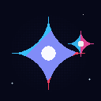
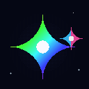

<div align="center">

# ✦ Google Gemini Descent ✦
### Cinematic Pixel Art Atmospheric Descent Simulator & GIF Animation Studio

<p align="center">
  
</p>

<p align="center">
  <strong>A cinematic 16-bit retro pixel art odyssey of the Google Gemini constellation descending from the thermosphere through dynamic cloud layers to the horizon</strong>
</p>

<p align="center">
  <strong>[🌐 English Documentation (Current)]</strong> &nbsp;·&nbsp; <a href="./redeamko.md"><strong>[🇰🇷 한국어 설명서 (Korean Version)]</strong></a>
</p>

<p align="center">
  
  
  
  
  
  
</p>

[✨ Live Features](#-key-features) · [🎬 Cinematic Viewpoints](#5--cinematic-viewpoints--quick-jump-engine) · [🎨 GIF Studio](#6--in-browser-gif-animation-studio-gif89a) · [🎮 Controls Guide](#-interactive-controls-guide) · [🚀 Getting Started](#-getting-started--local-development)

---

</div>

<br />

## 🌌 Overview

**Google Gemini Descent** is an interactive, cinematic web application rendering the **Google Gemini** constellation in handcrafted 16-bit retro pixel aesthetics. Embark on a hypnotic descent starting high in the upper atmosphere, piercing through procedural multi-layered cloud decks down toward vast planetary horizons.

The simulation combines an exact mathematical 4-pointed superellipse rasterizer, 4 atmospheric diurnal phases (Dawn, Golden Noon, Twilight, Midnight), 5 dynamic weather states, mythical **Celestial Dragon** flybys, a time-synced **Pixel Meteor Shower & Horizon Afterglow** system, an instant **Cinematic Viewpoint Bookmark Engine**, an **Observatory Codex** with trajectory density charts, and a client-side **GIF Animation Studio** powered by NeuQuant quantization.

<br />

---

## ✨ Key Features

### 1. ✦ 4-Point Superellipse Pixel Art Engine
- **Mathematical Astroid Curvature**: Implements `(|x|/a)^0.55 + (|y|/b)^0.55 <= 1` mapped onto a discrete pixel grid, reproducing Google Gemini's signature 4-pointed concave curvature with sub-pixel fidelity.
- **Iconic Brand Palette**: Luminous diamond-white core flanked by a smooth 6-stop spectrum: Cyan (`#38bdf8`), Cobalt (`#0ea5e9`), Violet (`#818cf8`), Purple (`#a855f7`), Magenta (`#f43f5e`), and Pink (`#ec4899`).
- **Companion Binary Satellite**: An orbital companion star executing a smooth 3D elliptical waltz around the primary constellation.

### 2. 🌠 Diurnal Pixel Meteor Shower & Horizon Residual Afterglow
- **Automatic Nighttime Cascade**: Triggers dynamic meteor cascades during Twilight and Midnight phases, casting luminous pixel streaks across the upper thermosphere.
- **Layered Flare Trails**: Core diamond flares with micro 4-axis cross-spikes and soft 32–60px gradient trails in vibrant cyan and violet.
- **Horizon Residual Light Afterglow**: Upon reaching the planetary horizon, meteors disperse kinetic energy into a glowing radial reservoir that gently illuminates the bottom of the viewport for 2.5–4.0 seconds.
- **Surge Trigger**: Manually unleash an immediate 6-burst meteor cascade at any moment via the bottom HUD control deck.

### 3. 🐉 Mythical Celestial Dragon Engine
- **Void Amethyst Celestial Dragon**: A 6-frame pixel art flight sprite engine with automatic chroma-key transparency, crystalline tail flares, a pulsating gem core, and trailing stardust emitter.
- **5 Chroma Element Variants**: Real-time HSL palette transforms for **Void Amethyst**, **Glacial Frost**, **Nebula Emerald**, **Solar Flare**, and **Crimson Inferno** dragons.
- **Atmospheric Shockwave**: Cloud velocity surges by **+275%** during a flyby while the Gemini constellation resonates with an ultra-bright chromatic glow.
- **Spatial Audio**: Procedurally synthesized wing flutter wind noise and low-frequency dragon roar with smooth 3-second envelope transitions.

### 4. 🪐 Multi-AI Constellations & Observatory Codex
- **OpenAI GPT**: Emerald quantum double-helix vortex with cybernetic high-frequency jitter.
- **Anthropic Claude**: Solar prominence gravitational parabolic arc with coronal seismic screen shake.
- **DeepSeek**: Fluid hydrodynamic sine-wave whale voyage with quantum sonar rings (oriented with directional head alignment).
- **Descent Trajectory & Density Chart (Recharts)**: Inside the Observatory Codex, view live telemetry graphs plotting altitude, atmospheric density, and gravitational drag curves for each AI constellation.
- **Cinematic Focus Tracking**: Smoothly zooms in (1.3x) on newly summoned celestial entities to track trajectories and particle exhausts before returning to normal view.

### 5. 🎬 Cinematic Viewpoints & Quick-Jump Engine
- **5 Iconic Handcrafted Presets**:
  - `Twilight Aurora Descent`: Ethereal green and violet auroral ribbons undulating through dusk clouds.
  - `Midnight Meteor Gala`: A cascade of pixel meteors illuminating deep space with horizon afterglow.
  - `Dawn Sea of Clouds`: Morning mist catching early golden rays with calm, serene gliding.
  - `Golden Hour Supernova`: High-noon brilliance with maximum solar lens flares and clear skies.
  - `Cyber Tempest Speedrun`: Mach acceleration penetrating an electric thundercloud tempest.
- **Custom Viewpoint Bookmarking**: Capture current diurnal progress, weather, speed mode, CRT scanlines, cloud density, and wind speeds with one click, persistently stored in `localStorage`.
- **HUD Quick-Jump Ribbon**: Switch seamlessly between bookmarked perspectives with zero transition latency.

### 6. 🎨 In-Browser GIF Animation Studio (`GIF89a`)
- **Real-Time 1:1 Pixel Canvas Preview**: Inspect, play, pause, and scrub through animation frames directly in the browser.
- **4 Tailored Animation Presets**:
  - `Combined Signature`: Core breathing glow + laser flare pulses + 360° chromatic hue rotation.
  - `Sparkle Blink`: Gentle pulsing with 4-axis starburst spikes and cosmic stardust particles.
  - `Color Cycle`: Smooth continuous phase-shift across the 6 Google brand colors.
  - `Frost Aurora`: Cyan and deep cobalt sub-zero polar aurora pulses.
- **Export Customization**: Resolutions (64×64, 128×128, 256×256), frame rates (10, 14, 20 FPS), loop durations (1.5s–3.0s), companion satellite toggle, and transparent alpha background support.
- **Instant Client-Side Export**: Encoded via NeuQuant color quantization directly into downloadable `.gif` files without external server requests.

### 7. 🎵 Procedural Cosmic Web Audio Soundscape
- Dynamic real-time wind sound generated through white noise generators and swept biquad lowpass filters.
- 55 Hz (A1) sub-bass cosmic drone supporting the deep atmospheric atmosphere.
- Crystalline synth chimes tuned to a celestial pentatonic scale.
- Responsive audio triggers for dragon encounters, meteor strikes, and UI interactions.

### 8. 🎛️ Atmospheric Layer Altimeter & Telemetry HUD
- **Real-Time Descent Ladder**: Continuous altitude monitoring from 140 km down to planetary surface (0 km) traversing **Thermosphere**, **Mesosphere**, **Stratosphere**, **Troposphere**, and **Planetary Surface**.
- **Environmental Telemetry**: Live readouts for Barometric Pressure (`hPa`), Temperature (`°C`), and Flight Velocity in **Mach** (`M 1.16`).
- **Re-entry Plasma Compression Glow**: Dynamic warning indicator flaring up during supersonic Mach bursts, layer boundary transitions, and dragon flybys.

### 9. ⌨️ Keyboard Command Deck & Hotkey Cheatsheet (`[?]` / `[H]`)
- **Direct Hotkey Navigation**: Control the descent entirely via keyboard:
  - `[Space]`: Toggle time auto-flow
  - `[1] ~ [4]`: Jump directly between Dawn, Golden Noon, Twilight, Midnight
  - `[D]`: Unleash Celestial Dragon encounter
  - `[M]`: Launch Pixel Meteor Shower cascade
  - `[G]`, `[C]`, `[S]`: Summon GPT, Claude, or DeepSeek
  - `[V]`: Open Viewpoints drawer
  - `[Z]`: Toggle Cinematic Zen Mode
  - `[?]` / `[H]`: Open HUD Hotkey Cheatsheet modal

### 10. 📊 8-Band Retro LED Audio Equalizer Visualizer
- Hardware-inspired 8-band pixel LED spectrum bar docked alongside the audio toggle.
- Dynamically responds to ambient wind velocity, cosmic sub-bass rumbles, crystalline meteor chimes, and dragon vocalizations with green-cyan-amber-rose gradations.

### 11. 🎬 Smart Idle Auto-Hide & Retro Sci-Fi Watermark
- **Smart Zen Auto-Fade**: Seamlessly hides top and bottom HUD decks and cursor after 3.5 seconds of inactivity, returning to full visibility instantly on mouse or key input.
- **4x Lossless PNG Watermark**: Exported snapshots feature a retro sci-fi bottom telemetry strip (`✦ GOOGLE GEMINI DESCENT // ALT 42.8 KM // TWILIGHT AURORA · CLEAR`).

### 12. ✨ Interactive Cursor Starlight Trail & Click Nova Burst
- **Motion-Responsive Starlight Trail**: Moving the cursor across the canvas emits delicate pixel starlight sparks and fading chromatic afterglow trails (Cyan `#38bdf8`, Violet `#818cf8`, Stardust Gold `#fde047`, and Core White `#ffffff`).
- **Click Nova Burst Flare**: Clicking or tapping on the canvas triggers a 16-point radial starlight nova explosion and expanding shockwave ring, accompanied by a crystalline synth sparkle chime.

### 13. 📹 In-Browser 60FPS Video Recorder (WebM/MP4 Camcorder `[R]`)
- **Direct 60FPS Canvas Capture**: Records high-framerate clips straight from the internal 480×300 buffer using `HTMLCanvasElement.captureStream(60)`.
- **Vintage Camcorder HUD**: Real-time pulsing `● REC 00:04:12 [60 FPS // HD]` indicator in the top-left corner during active capture.
- **Universal Codec Fallback**: Automatically prioritizes `video/webm;codecs=vp9`, falling back to VP8 or MP4 with safety caps at 60 seconds.
- **Instant Hotkey & Toolbar Trigger**: Start and stop recordings via hotkey `[R]` or the dedicated toolbar camcorder button.

### 14. 🕹️ Steerable Glider Flight Steering Mode (`[X]`) & Auto-Pilot Smoothing (`[Y]`)
- **Directional Aerodynamic Controls**: Take manual flight control of the Google Gemini star using `[WASD]` or `[Arrow Keys]`.
- **Realistic Banking Roll**: Smoothly interpolates banking roll angles into turns with natural inertia and auto-centering physics.
- **Auto-Pilot Input Smoothing (`[Y]`)**: Slew-rate limits banking angular velocity and filters rapid directional reversals, preventing violent snaps and whiplash on rapid alternating keystrokes.
- **Dynamic Pulsing Status Indicator**: A framer-motion HUD badge that dynamically pulses in glowing emerald (`SMOOTHING`) when auto-pilot is actively damping inputs and stabilizes to cyan (`ACTIVE`) during cruise.
- **Plasma Thruster Plumes**: Generates high-velocity cyan, violet, and core white plasma rocket exhaust plumes sloughing behind the star during maneuvers.
- **Live Flight HUD**: Displays live roll angle readouts (`ROLL +12.4°`), coordinate offsets, and interactive Auto-Pilot toggle.

### 15. 🗺️ Constellation Star-Chart & Lore Navigation (`[K]`)
- **Celestial Asterisms**: Renders historic connected asterisms across the high stratosphere, including **Ursa Major** (Big Dipper), **Cassiopeia** (Queen's Throne), and **Gemini Twins Nexus** (Castor & Pollux).
- **Neon Dashed Geometry**: Connected with cyan and violet dashed celestial lines and pulsating star nodes.
- **Interactive Proximity Lore Cards**: Hovering or clicking near asterism stars reveals historical lore, primary stars, and astronomical coordinates in real-time.

### 16. 📻 3-Channel Cosmic Lo-Fi Synth Radio
- **3 On-Air Synthesizer Channels**:
  - `Deep Space Drone`: 55 Hz sub-bass sine wave meditation and filtered interstellar solar wind noise.
  - `Lo-Fi Stardust Lounge`: Gentle nostalgic tape warmth with procedural pentatonic Rhodes-style star chimes.
  - `Cyber Tempest Pulse`: 128 BPM 16th-note arpeggiated electro bass pulses and sweep filters.
- **Live Switcher in Soundscape Studio**: Integrated seamlessly into the Cosmic Soundscape Studio with "ON AIR" status indicators and volume scaling.

### 17. 🌌 Black Hole Gravitational Lensing & Event Horizon Distortion (`[B]`)
- **Relativistic Doppler Accretion Disk**: High-velocity orbital ring with asymmetric Doppler beaming (approaching cyan blueshift and receding magenta redshift).
- **Gravitational Space-Time Warping**: Inverse-distance gravitational pull vectors dynamically tug the Google Gemini star, steerable glider flight path, and cursor starlight particles toward the singularity.
- **Concentric Distortion Ripples**: Pulsating gravitational lensing rings, photon spheres, and a pitch-black event horizon core.
- **Sub-Bass Gravitational Wave Audio**: 38 Hz sub-bass rumble combined with exponential frequency sweep shears mimicking space-time compression.

### 18. 🕹️ Arcade Stardust Ring Collector & Scoring Challenge Mode (`[T]`)
- **Ascending Neon Stardust Rings**: Precision stardust rings drift upward through atmospheric strata with pulsing neon beacons and rotating guide stars.
- **Dynamic Collision & Combo Multipliers**: Continuous collision detection with the Gemini constellation rewarding streaks with escalating combo tiers (`x1`, `x2`, `x4`, `x8`).
- **Retro Arcade HUD & Persistent High Score**: Real-time score ticker, combo banner, and all-time best score automatically saved in browser `localStorage`.
- **Ascending Harmonic Audio Chimes**: Pentatonic crystalline audio chimes ascending in pitch with combo streaks.

### 19. 🛰️ Low-Earth Orbit Satellite Constellation & Space Station Flybys
- **Authentic 16-Bit Spacecraft Sprites**: Procedurally animated orbital passes featuring the **International Space Station (ISS)**, **Hubble Space Telescope**, **Voyager 1**, and a tandem **Starlink Satellite Train**.
- **Orbital Kinematics**: Realistic horizontal traversal across upper thermosphere corridors (100–140 km) with solar panel specular glints and blinking navigation LEDs.
- **Interactive Telemetry Cards**: Hovering reveals live orbital velocity (`km/s`), altitude (`km`), orbital inclination, launch year, and historical mission codex.
- **Interactive Morse Radio Ping**: Clicking any passing satellite broadcasts a synthesized radio telemetry beep.

### 20. ⚡ Supercell Dynamic Thunderstorm & Fractal Lightning Fork System
- **Recursive Fractal Branching Lightning**: Forked electric discharges branching dynamically from storm cloud centers down through atmospheric layers.
- **Volumetric Back-Illumination**: Thunderstorm clouds light up from within during strikes, dynamically casting bright ambient flashes across the canvas.
- **St. Elmo's Fire Electrostatic Sparks**: High-voltage electrostatic corona discharges crackle across the four sharp tips of the Gemini constellation during active storms.
- **Acoustic Speed-of-Sound Thunderclaps**: Low-frequency resonant thunderclaps with realistic multi-echo reverbs delayed by distance.

### 21. 🛡️ Product-Grade Stabilization & Crash Resilience Architecture
- **Centralized Simulation Store**: Unified state management through a typed reducer (`SimulationContext`) eliminating prop fragmentation and guaranteeing deterministic physics state transitions.
- **Resilient React Error Boundary**: Gracefully catches canvas rasterizer, Web Audio context, or rendering anomalies, presenting an interactive "Re-establish Telemetry Link" recovery interface rather than crashing.
- **Comprehensive Boundary & Stress Testing**: Hardened with 219 passing automated unit and integration tests across 18 test suites covering rapid frame cycling, extreme telemetry bounds, system time night detection, encounter shake scaling, and Gaussian blur soft shadows.

### 22. ⚙️ Persistent Flight System Preferences & Audio Profile Modal (`[,]`)
- **Granular Visual Performance Budgets**: Particle density capacity scaler (`Low` / `Balanced` / `Ultra`), refresh rate target (30 FPS / 60 FPS / Uncapped), seismic screen shake slider, CRT scanlines, and bloom toggles.
- **Studio Audio Mixer Console**: Independent volume faders for Master Gain, Atmospheric Wind, Lo-Fi Synthesizer Radio, and Interactive SFX Chimes with background tab auto-mute.
- **Zero-Crash Storage Sanitization**: Type-safe local schema validator automatically normalizes corrupted or outdated preference records back to healthy factory defaults.

### 23. 🌐 Interactive 3D Constellation Hologram & Celestial Coordinates (`ObservatoryCodexModal`)
- **Euler 3D Celestial Sphere Engine**: Real-time perspective projection with Euler pitch, yaw, and roll gimbal rotations, rendering orbital celestial rings (Equator, Meridian, NCP Polar Axis) and connected 3D asterisms for all 4 AI constellations (Gemini, GPT, Claude, DeepSeek).
- **Sub-Pixel Raycast Star Hit-Testing & Reticle**: Interactive raycast detection accurately identifies clicks on 3D star nodes, triggering glowing targeting reticles and visual coordinate emphasis.
- **Real-Time Astronomical HUD & Sky Dome Radar**: Computes and displays exact Right Ascension (RA $\alpha$), Declination (Dec $\delta$), local Altitude/Azimuth coordinates, and Epoch J2000, paired with a floating circular mini sky-dome radar projection.
- **Dual Observatory Simulation Modes**: Seamlessly switch between the **3D Celestial Hologram & Coordinates** viewer and the **2D Atmospheric Particle Emitter Simulator** inside the Observatory Codex.

### 24. 🎧 Weather-Driven 3D Spatial Audio & Dynamic Filter Matrix (`SoundscapeMixerModal`)
- **Acoustic Weather Coupling**: Dynamic DSP biquad filtering and resonance modulation tailored in real time to the active weather mode:
  - *Thunderstorm*: Resonant low-frequency sub-bass thunderclaps and speed-of-sound reverberation.
  - *Aurora*: Ethereal harmonic synth swells with dynamic bandpass resonance sweeps.
  - *Snow & Mist*: Acoustic low-pass muffled dampening and high-altitude whisper noise.
  - *Golden Clear*: Sparkling high-frequency crystalline chimes and celestial shimmer.
- **Spatial Acoustic Panning & Master Mixer**: Dual-channel stereo spatial panning, independent gain buses, and background tab auto-suspend.

### 25. ☁️ Physically-Coupled Cloud Aerodynamics & Wind Shear (`AtmosphereStudioDrawer`)
- **Aerodynamic Drag & Velocity Coupling**: Cloud layer flow velocity and volumetric density dynamically adapt to current weather conditions, altitude barometric strata, and flight velocity (Mach burst acceleration).
- **Multi-Strata Wind Shear**: Simulates stratified atmospheric wind shear across Thermosphere, Mesosphere, and Stratosphere layers with real-time Reynolds turbulence.

### 26. 💾 Flight State JSON Export & Import Engine (`SettingsModal`)
- **1-Click JSON Flight Telemetry Export**: Download real-time simulation snapshot (altitude/cycle progress, weather, speed mode, custom atmosphere parameters, view layout, CRT scanlines, glider/star-chart/arcade mode states) as a standalone `.json` file (`gemini_flight_session_<timestamp>.json`).
- **Resilient JSON Import & Auto-Restoration**: Drag or select any previously exported flight session JSON file; safely validates with `sanitizeFlightSession`, syncs to `localStorage`, and instantly applies the flight state to the live canvas simulation with HUD toast feedback.
- **Dual Backup Modes**: Independent controls for full career Blackbox Profile backups (stats, high scores, viewpoints, settings) and Live Flight Session State backups.

### 27. 🌫️ Altitude & Weather Responsive `AtmosphericHazeFilter` (`PixelDescentCanvas`)
- **Dynamic Optical Clarity & Depth Scattering**: Real-time atmospheric density calculation that progressively softens and diffuses the viewport as altitude descends from the crystal-clear vacuum of the Thermosphere (140 km) into the dense troposphere and surface (0 km).
- **Weather-Specific Chromatic Veils**:
  - *Mist*: Dense pearlescent fog scattering with soft contrast dampening and airlight lift.
  - *Rain*: Humid slate-blue atmospheric softening and desaturation.
  - *Snow*: Crystalline frosty white shimmer with soft high-key diffusion.
  - *Aurora*: Ionized emerald-violet polar luminescence haze.
  - *Clear*: Natural golden-hour Rayleigh horizon scattering.
- **Hybrid In-Canvas & Viewport Post-Processing**: Blends in-canvas volumetric gradient passes with hardware-accelerated dynamic canvas CSS filters (`blur`, `contrast`, `brightness`, `saturate`) and floating aerosol vapor nodes for immersive depth.

### 28. 🌦️ Dynamic Atmospheric Weather Transition Engine (`weatherTransitionEngine.ts`)
- **Natural Particle Front Sweeping**: Smooth progressive blending between weather conditions (Rain, Snow, Mist, Aurora, Clear) with directional atmospheric condensation fronts.
- **Dynamic Transition Particles**: Spawns specialized motes (drifting crystalline ice needles, rain condensation, vapor fog clouds, ion flare motes) that bridge climatic shifts naturally.

### 29. ☁️ Real-Time Dynamic Opacity & Color Depth `CloudShadowEngine` (`PixelDescentCanvas`)
- **Altitude-Coupled Perceptual Darkness & Sharpness**: Monotonically darkens and tightens cloud shadow umbra cores as altitude descends from 140 km down to the troposphere (<15 km).
- **Wind-Driven Sliding Drift Animation**: Real-time terrain-sliding drift kinematics reflecting prevailing wind velocity (`windX`) and vertical airflow (`windSpeed`), including aerodynamic wind shear tilting and trail stretching.
- **Dynamic Opacity & Rich Color Depth (Density) Modulation**:
  - *Atmospheric Boundary Layer Convection*: Calculates organic multi-frequency breathing waves (`calculateDynamicShadowModulation`) with higher harmonic turbulence in dense troposphere (<15 km) and subtle laminar fluctuations in upper space.
  - *Weather-Coupled Hue & Saturation Tuning*: Dynamically modulates shadow RGB depth and contrast across storm rain (deep obsidian charcoal gloom), crisp alpine snow (high-contrast indigo), diffused mist (softened low-contrast slate), polar aurora (geomagnetic violet-cyan resonance), and golden clear sunlight.
- **Diagnostic Debug Overlay Mode (`[U]`)**:
  - Interactive canvas HUD (`renderCloudShadowDebugOverlay`) projecting dotted ray vectors from clouds down to ground terrain, wireframe footprint ellipses, inner umbra core perimeters, and a retro sci-fi top-right telemetry terminal box displaying altitude, a 10-segment opacity meter bar, optical density multiplier, color depth, drift velocities, and convective breathing wave status.
- **Real-Time Altitude Density Metric Tooltip**:
### 30. 🌙 Local System Time Night Mode & Cosmic Midnight Environment (`systemTimeAutoTheme.ts`)
- **Automated Local Time Detection**: Seamlessly detects the user's local device clock on launch.
- **Nighttime Auto-Load (8:00 PM ~ 6:00 AM)**: When launching between 20:00 and 06:00, automatically activates the **Dark Mode** interface theme, sets the flight diurnal progression to **Phase 3 (Cosmic Midnight, `cycleProgress = 0.77`)**, and activates atmospheric **Alpine Snowfall** weather.
- **Interactive Sci-Fi HUD Toast Notification**: Welcomes pilots with a 7-second auto-dismissing telemetry banner displaying detected local time, active phase, and quick dismissal.
- **Customizable Preference Toggle**: Configurable anytime inside the Settings Preferences Modal (`[,]` / `SettingsModal`) under Accessibility & UX (`autoSystemNightTheme`).

### 31. 🌫️ Gaussian Blur Soft Shadow Filtering in `CloudShadowEngine`
- **Natural Atmospheric Penumbra Diffusion**: Integrates hardware-accelerated Gaussian blur filter passes (`ctx.filter = 'blur(...)px'`) during canvas rasterization, eliminating harsh artificial pixel boundaries and recreating organic atmospheric light dispersion across planetary terrain.
- **Altitude-Adaptive Penumbra Width**:
  - *High Altitudes (60 km ~ 140 km)*: Extended Rayleigh scattering through thick atmospheric columns spreads shadow boundaries into a soft, broad penumbra (3.5px ~ 6.0px).
  - *Low Troposphere (< 15 km down to 0 km)*: Direct ground proximity contracts penumbral spread into tight, sharp boundaries (0.8px ~ 1.8px) with a concentrated inner umbra core.
- **Weather-Coupled Dispersion Modulation**: Atmospheric mist and fog expand light scattering (+1.4px blur), rainstorm cloud cover adds dense gloom diffusion (+0.6px), while cold alpine snow enhances optical clarity with crisper edges (-0.3px).
- **Live Telemetry & Diagnostic HUD Integration**: Dynamic Gaussian blur radius displayed in real time inside the Debug Telemetry Terminal (`[U]`) and interactive floating cursor tooltip.

### 32. ⚡ Celestial Encounter Shake Intensity Slider (`1 ~ 10`) & Global Event Dispatch
- **Fine-Grained Tactile Control**: Interactive 1 to 10 slider in the Settings Preferences Modal (`SettingsModal` / `[,]`) under Graphics Performance, controlling screen jitter displacement and haptic vibration feedback intensity during AI constellation encounters (GPT, Claude, DeepSeek) and black hole singularity summons.
- **Global State Synchronization**: Managed centrally within `UserSettingsProfile` (`encounterShakeIntensity`) and `SimulationContext` (`SET_ENCOUNTER_SHAKE_INTENSITY`), automatically persisted to `localStorage` with resilient schema normalization.
- **Dynamic Physics Modulation in `handleEncounterTrigger`**:
  - *Displacement Scaling*: Computes dynamic jitter multipliers ($0.35\times$ at Level 1 up to $1.80\times$ at Level 10) applied to `<motion.div animate={getScreenJitterKeyframes(multiplier)}>`.
  - *Haptic Duration & Pulse Scaling*: `getHapticPattern` and `triggerCelestialHaptic` dynamically stretch and compress vibration duration across levels.
  - *Dynamic Jitter Jolt Lifetime*: Automatically adjusts impact timeout from 320ms (Level 1) up to 520ms (Level 10).

### 33. 🎬 Fluid Framer Motion `layoutId` Bottom Footer Transitions
- **`<LayoutGroup id="bottom-footer-hud-controls">` Orchestration**: Seamlessly coordinates layout animations between the full **Standard** bottom control deck and the compact **Cinematic** floating dock at the bottom-right corner.
- **Shared Morphing Controls with Coordinated `layoutId`s**:
  - `footer-btn-layout-toggle`: Fluidly glides and interpolates between the "Cinematic [Z]" button and the "Show Controls [Z]" button.
  - `footer-btn-play-pause`: Time auto-progression play/pause toggle glides between deck center and dock.
  - `footer-btn-viewpoints`: Viewpoint bookmark manager button glides smoothly between the quick jump ribbon and dock.
  - `footer-btn-codex`, `footer-btn-atmosphere`, `footer-btn-gif-studio`, `footer-btn-soundscape`: 1-to-1 morphing for the Celestial Codex, Atmosphere Studio, GIF Studio, and Soundscape Mixer buttons.
- **Elastic Component Re-arrangement**: Weather chips, entity summon buttons, time scrubbers, phase selectors, and speed controls all feature spring-based `layout` interpolation (`stiffness: 340, damping: 28`), preventing visual snapping and offering tactile, buttery smooth responsiveness.

### 34. 🐉 Canvas Center Proximity Dynamic Dragon Audio Cross-fading (`dragonAudioProximity.ts`)
- **Proximity-Driven Real-Time Volume Interpolation**: Dynamically adjusts roar and wing flap volume based on the dragon's continuous distance to the canvas center ($x = \text{width} / 2$). The roar builds into a thunderous crescendo as the dragon approaches dead center and gently decrescendos into silence as it traverses past toward the horizon.
- **$C^1$-Continuous Cosine Easing Curve**:
  - Employs $\text{proximity} = 0.5 \times (1 + \cos(\text{norm} \times \pi))$ with zero derivative at both apex ($1.0$) and audible boundaries ($0.0$), eliminating audio pops, clicks, or abrupt gain steps.
- **Dynamic Acoustic Spectrum & 3D Spatial Panning**:
  - *Dynamic Lowpass Filter Cutoff*: Opens from a low muffled 120Hz sub-rumble at distant entry to an expansive 440Hz resonant roar at peak center proximity.
  - *Continuous Stereo Panner*: Follows the dragon's trajectory across the screen, smoothly shifting from $-1.0$ (far left) through $0.0$ (canvas center) to $+1.0$ (far right).
  - *Graceful Decay*: Seamlessly cross-fades out via `stopDragonRoarAudio(0.6)` once the dragon exits the viewport or ambient sound is muted.

<br />

---

## 🖼️ Pre-rendered GIF Showcase

Static high-fidelity GIF assets pre-rendered and bundled within `/public`:

| Combined Signature Loop | Starlight Sparkle | Spectrum Color Cycle |
|:---:|:---:|:---:|
|  |  |  |
| **`gemini_pixel_animated.gif`**<br/>37.2 KB · 14 FPS · 2.0s Loop | **`gemini_pixel_sparkle.gif`**<br/>33.8 KB · 12 FPS · 2.0s Loop | **`gemini_pixel_color_cycle.gif`**<br/>61.4 KB · 12 FPS · 2.5s Loop |
| Core glow + laser flare + 360° chromatic rotation | White core pulse + 4-axis cross flare | Smooth 6-stop brand gradient phase rotation |

<br />

---

## 🎮 Interactive Controls Guide

Control flight physics and atmospheric parameters via HUD decks and hotkeys:

```
┌────────────────────────────────────────────────────────────────────────┐
│ [Top Navigation Deck]                                                  │
│   • View Modes: [Standard HUD] / [Split Radar Observatory] / [Zen]    │
│   • Celestial Codex: Deep-dive specs, 3D hologram & trajectory charts  │
│   • Atmosphere Studio: Sliders for cloud density, wind speed & shake   │
│   • GIF Studio: Customize, preview, and encode pixel art GIF loops    │
│   • Viewpoints: Load presets or bookmark custom weather combinations   │
│   • Audio Spectrum: 8-band dancing LED visualizer + soundscape mixer   │
│   • Shortcuts [?]: Instant retro keyboard command cheatsheet overlay   │
│   • Pixel Capture: Snapshot frame into 4x PNG with telemetry watermark │
├────────────────────────────────────────────────────────────────────────┤
│ [Bottom Flight Control Deck]                                           │
│   • Quick-Jump Ribbon: Instant one-click jump to favorite viewpoints   │
│   • Weather Presets: [Auto-Cycle] [Rain] [Snow] [Mist] [Aurora] [Clear]│
│   • Constellation Rendezvous: [GPT] [Claude] [DeepSeek]               │
│   • Special Events: [Dragon Flyby] (Nebula Dragon) / [Meteor Shower]   │
│   • Diurnal Jumper: [Dawn] [Golden Noon] [Twilight] [Midnight]         │
│   • Descent Speed: [Cinematic (0.55x)] [Normal (1.0x)] [Mach (2.2x)]   │
│   • Visual Filters: Toggle CRT phosphor scanlines & star trail vectors │
└────────────────────────────────────────────────────────────────────────┘
```

<br />

---

### 10. 🛡️ Product-Grade Architecture & Hardening Engine
- **Automatic Flight Session Recovery Engine**: Persists altitude, cycle progression, weather mode, custom atmosphere parameters, active viewpoints, layout mode, and operational toggles to local storage with lifecycle hooks (`beforeunload`, `visibilitychange`) and 2.5s throttling to guarantee zero state loss on refresh or browser exit. Includes a non-intrusive restore notification toast with instant 1-click session reset.
- **Canvas Context Loss & GPU Recovery Engine**: Listens for hardware context loss (`contextlost`, `contextrestored`), invokes `preventDefault()` to prevent canvas destruction, pauses simulation ticks, and seamlessly re-acquires 2D context and re-initializes sprite buffers without page reload.
- **Zero-Allocation Particle Object Pooling**: Pre-allocates fixed particle memory pools with O(1) swap-and-pop recycling, eliminating heap allocations in hot render loops and preventing GC micro-stutters.
- **Input Focus & Ghosting Guard**: Cleans up keyboard steering state on window blur events (`Alt-Tab`, tab switches) to prevent persistent control drift.
- **Flight Mode Profiles & Integrated Presets**: Bundles graphic quality, particle budgets, target FPS, CRT scanlines, bloom, screen shake, and master audio levels into unified 1-click profiles (*Cinematic Odyssey*, *Performance & Eco*, *Retro CRT Arcade*, *Silent Meditation Zen*) plus custom user profile bookmarking with real-time active profile detection.
- **Altitude & Wind-Driven Terrain Cloud Shadow Engine (`cloudShadowEngine`)**: Real-time projection of volumetric cloud shadows draped across continents, oceans, and mountain ridges clipped precisely to planetary curvature. Features continuous wind direction and velocity-driven gliding drift animation, undulating terrain elevation parallax, aerodynamic shear elongation, and altitude-driven optical deepening (faint penumbra at 140km to crisp, dense umbra at 0.4km).
- **Atmospheric Weather Particle Transition Engine (`weatherTransitionEngine`)**: Seamlessly cross-fades precipitation particles (raindrops, snowflakes, mist banks, aurora curtains) across weather changes using mathematical smoothstep easing. Spawns dynamic meteorological front boundary veils and thematic transition motes (vapor swirls, ice condensation crystals, ion flares, thermal steam) with real-time HUD front progression.
- **Atmospheric Haze Depth Filter (`AtmosphericHazeFilter`)**: Multi-layer optical scattering dynamically adjusts contrast, brightness, and backdrop blur based on current altitude and diurnal weather cycle, rendering palpable atmospheric depth as the glider descends into lower planetary layers.
- **Flight Telemetry Blackbox & State Import/Export**: Career stats tracking and instant JSON state file export/import in `SettingsModal` allowing seamless cross-device synchronization and session backup.
- **Multi-Language Localization (i18n)**: Instant runtime toggle between English and Korean (`[KO / EN]`) with persistent language selection.
- **Flight Log Blackbox & Profile Backup/Restore**: Complete career statistics tracking (distance, rings collected, high scores, cycles) with 1-click JSON backup export and schema-validated JSON import.
- **Adaptive Performance Guard**: Rolling frame time variance analysis with automatic particle budget downgrading (`ultra` -> `balanced` -> `low`) during performance degradation and seamless recovery.
- **Web Audio Tab-Visibility Auto-Suspend**: Automatic suspension and smooth resumption of Web Audio nodes on tab blur to conserve battery and CPU.
- **Progressive Web App (PWA) Support**: Web App Manifest and offline caching service worker for standalone deployment and offline execution.
- **Cinematic 3D Space-to-Cloud Orbital Descent Ingress Engine (`cinematicOrbitalZoomEngine`)**: Smoothly transitions from orbital space (380 km / Thermosphere) through hypersonic re-entry (Mesosphere/Stratosphere) down into the Troposphere cloud layer (~12 km) upon initial startup or when a new flight session is initiated (`[I]`). Features 3D camera pitch tilt (`-0.14 rad` to `0 rad`), dynamic zoom scaling (`0.32x` -> `1.08x` -> `1.00x`), planetary atmosphere horizon limb, radial hyperspace starlight warp streaks, ionization plasma shockwaves, and cloud breakthrough vapor condensation mist, accompanied by a procedural Web Audio API supersonic sound sequence and real-time Ingress HUD telemetry.
- **Flight Log Badge & Milestone Achievement Engine (`flightLogBadgeEngine`)**: Evaluates real-time flight conditions and rewards unlockable achievement badges displayed on the HUD deck (e.g. `Cloud Piercer` for penetrating heavy storm layers, `Orbital Ingress`, `Dragon Whisperer`, `Stardust Ace`, `Aurora Navigator`, `Horizon Touchdown`, `Mach Pilot`, `Event Horizon`). Features real-time animated Framer Motion toast banners, procedural Web Audio fanfare arpeggio, persistent storage, and an interactive showcase deck with expandable details.

<br />

---

## 🛠️ Tech Stack

- **UI Framework**: React 19 (Hooks, Functional Component Architecture)
- **Language**: TypeScript 5 (Strict Mode, 0 Linter Errors)
- **Styling**: Tailwind CSS v4 + Framer Motion
- **Graphics Pipeline**: HTML5 Canvas 2D (`imageSmoothingEnabled: false`) & 3D Math Engine (Euler Rotations, Raycasting, Perspective Projections)
- **Data Visualization**: D3.js (Telemetry & Trajectory Density graphs)
- **GIF Encoding**: `gifenc` (NeuQuant color quantization, binary GIF89a serialization)
- **Audio Synthesizer**: Web Audio API (BiquadFilter, OscillatorNode, GainNode, Weather DSP Matrix)
- **Icons**: Lucide React
- **Build Tooling**: Vite 6, TSX, Node.js Built-in Test Runner (`node:test`)

<br />

---

## 🚀 Getting Started & Local Development

### Prerequisites
- Node.js 18.0.0 or higher
- npm, pnpm, or bun

### 1. Clone & Install Dependencies
```bash
git clone https://github.com/rt030627-rgb/Google-ai-studio.git
cd Google-ai-studio
npm install
```

### 2. Launch Development Server
```bash
npm run dev
```
Open `http://localhost:3000` in your browser to experience the cinematic pixel art descent.

### 3. Run Automated Unit Tests
```bash
npm test
```
*Executes all 208 unit and stress tests across 17 test suites verifying altitude & wind-driven cloud terrain shadows (monotonic alpha scaling, sharpness, diurnal sun vectors, wind drift kinematics, aerodynamic shear, layer parallax, real-time dynamic opacity and color depth modulation, boundary layer convection, diagnostic debug overlay mode, real-time altitude density metric calculations, hover tooltip telemetry), atmospheric weather particle transitions (smoothstep front sweeps, dynamic blend weights, condensation motes), flight mode profiles (built-in presets, custom save/delete, deep matching), atmospheric haze optical formulas, batched constellation rendering paths, AABB spatial bounds culling, multi-constellation scaling, 3D constellation mathematical topologies, Euler rotation vector norms, perspective raycast hit-testing, weather DSP audio matrices, flight session auto-recovery, geometry formulas, trajectory physics, residual afterglows, dragon sprite engines, viewpoint storage, black hole gravity, arcade scoring, satellite kinematics, lightning fractals, i18n key parity, blackbox backup validation, adaptive quality guards, particle pool O(1) recycling, GPU context recovery, and Web Audio safety.*

### 4. Build for Production
```bash
npm run build
```

### 5. Regenerate Bundled GIFs via CLI
```bash
npx tsx scripts/generate-gemini-gif.ts
```

<br />

---

## 📄 License

This project is licensed under the **Apache-2.0 License** - see the LICENSE file for details.

<br />

<div align="center">
  <sub>Crafted with passion for pixel art and cosmic aesthetics ✦ Powered by Google Gemini & DeepMind Spirit</sub>
</div>
