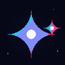
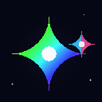

<div align="center">

# ✦ Google Gemini Descent ✦
### Cinematic Pixel Art Atmospheric Descent Simulator & GIF Animation Studio

<p align="center">
  
</p>

<p align="center">
  <strong>A cinematic 16-bit retro pixel art odyssey of the Google Gemini constellation descending from the thermosphere through dynamic cloud layers to the horizon</strong>
</p>

<p align="center">
  <strong>[🌐 English Documentation (Current)]</strong> &nbsp;·&nbsp; <a href="./redeamko.md"><strong>[🇰🇷 한국어 설명서 (Korean Version)]</strong></a>
</p>

<p align="center">
  
  
  
  
  
  
</p>

[✨ Live Features](#-key-features) · [🎬 Cinematic Viewpoints](#5--cinematic-viewpoints--quick-jump-engine) · [🎨 GIF Studio](#6--in-browser-gif-animation-studio-gif89a) · [🎮 Controls Guide](#-interactive-controls-guide) · [🚀 Getting Started](#-getting-started--local-development)

---

</div>

<br />

## 🌌 Overview

**Google Gemini Descent** is an interactive, cinematic web application rendering the **Google Gemini** constellation in handcrafted 16-bit retro pixel aesthetics. Embark on a hypnotic descent starting high in the upper atmosphere, piercing through procedural multi-layered cloud decks down toward vast planetary horizons.

The simulation combines an exact mathematical 4-pointed superellipse rasterizer, 4 atmospheric diurnal phases (Dawn, Golden Noon, Twilight, Midnight), 5 dynamic weather states, mythical **Celestial Dragon** flybys, a time-synced **Pixel Meteor Shower & Horizon Afterglow** system, an instant **Cinematic Viewpoint Bookmark Engine**, an **Observatory Codex** with trajectory density charts, and a client-side **GIF Animation Studio** powered by NeuQuant quantization.

<br />

---

## ✨ Key Features

### 1. ✦ 4-Point Superellipse Pixel Art Engine
- **Mathematical Astroid Curvature**: Implements `(|x|/a)^0.55 + (|y|/b)^0.55 <= 1` mapped onto a discrete pixel grid, reproducing Google Gemini's signature 4-pointed concave curvature with sub-pixel fidelity.
- **Iconic Brand Palette**: Luminous diamond-white core flanked by a smooth 6-stop spectrum: Cyan (`#38bdf8`), Cobalt (`#0ea5e9`), Violet (`#818cf8`), Purple (`#a855f7`), Magenta (`#f43f5e`), and Pink (`#ec4899`).
- **Companion Binary Satellite**: An orbital companion star executing a smooth 3D elliptical waltz around the primary constellation.

### 2. 🌠 Diurnal Pixel Meteor Shower & Horizon Residual Afterglow
- **Automatic Nighttime Cascade**: Triggers dynamic meteor cascades during Twilight and Midnight phases, casting luminous pixel streaks across the upper thermosphere.
- **Layered Flare Trails**: Core diamond flares with micro 4-axis cross-spikes and soft 32–60px gradient trails in vibrant cyan and violet.
- **Horizon Residual Light Afterglow**: Upon reaching the planetary horizon, meteors disperse kinetic energy into a glowing radial reservoir that gently illuminates the bottom of the viewport for 2.5–4.0 seconds.
- **Surge Trigger**: Manually unleash an immediate 6-burst meteor cascade at any moment via the bottom HUD control deck.

### 3. 🐉 Mythical Celestial Dragon Engine
- **Void Amethyst Celestial Dragon**: A 6-frame pixel art flight sprite engine with automatic chroma-key transparency, crystalline tail flares, a pulsating gem core, and trailing stardust emitter.
- **5 Chroma Element Variants**: Real-time HSL palette transforms for **Void Amethyst**, **Glacial Frost**, **Nebula Emerald**, **Solar Flare**, and **Crimson Inferno** dragons.
- **Atmospheric Shockwave**: Cloud velocity surges by **+275%** during a flyby while the Gemini constellation resonates with an ultra-bright chromatic glow.
- **Spatial Audio**: Procedurally synthesized wing flutter wind noise and low-frequency dragon roar with smooth 3-second envelope transitions.

### 4. 🪐 Multi-AI Constellations & Observatory Codex
- **OpenAI GPT**: Emerald quantum double-helix vortex with cybernetic high-frequency jitter.
- **Anthropic Claude**: Solar prominence gravitational parabolic arc with coronal seismic screen shake.
- **DeepSeek**: Fluid hydrodynamic sine-wave whale voyage with quantum sonar rings (oriented with directional head alignment).
- **Descent Trajectory & Density Chart (Recharts)**: Inside the Observatory Codex, view live telemetry graphs plotting altitude, atmospheric density, and gravitational drag curves for each AI constellation.
- **Cinematic Focus Tracking**: Smoothly zooms in (1.3x) on newly summoned celestial entities to track trajectories and particle exhausts before returning to normal view.

### 5. 🎬 Cinematic Viewpoints & Quick-Jump Engine
- **5 Iconic Handcrafted Presets**:
  - `Twilight Aurora Descent`: Ethereal green and violet auroral ribbons undulating through dusk clouds.
  - `Midnight Meteor Gala`: A cascade of pixel meteors illuminating deep space with horizon afterglow.
  - `Dawn Sea of Clouds`: Morning mist catching early golden rays with calm, serene gliding.
  - `Golden Hour Supernova`: High-noon brilliance with maximum solar lens flares and clear skies.
  - `Cyber Tempest Speedrun`: Mach acceleration penetrating an electric thundercloud tempest.
- **Custom Viewpoint Bookmarking**: Capture current diurnal progress, weather, speed mode, CRT scanlines, cloud density, and wind speeds with one click, persistently stored in `localStorage`.
- **HUD Quick-Jump Ribbon**: Switch seamlessly between bookmarked perspectives with zero transition latency.

### 6. 🎨 In-Browser GIF Animation Studio (`GIF89a`)
- **Real-Time 1:1 Pixel Canvas Preview**: Inspect, play, pause, and scrub through animation frames directly in the browser.
- **4 Tailored Animation Presets**:
  - `Combined Signature`: Core breathing glow + laser flare pulses + 360° chromatic hue rotation.
  - `Sparkle Blink`: Gentle pulsing with 4-axis starburst spikes and cosmic stardust particles.
  - `Color Cycle`: Smooth continuous phase-shift across the 6 Google brand colors.
  - `Frost Aurora`: Cyan and deep cobalt sub-zero polar aurora pulses.
- **Export Customization**: Resolutions (64×64, 128×128, 256×256), frame rates (10, 14, 20 FPS), loop durations (1.5s–3.0s), companion satellite toggle, and transparent alpha background support.
- **Instant Client-Side Export**: Encoded via NeuQuant color quantization directly into downloadable `.gif` files without external server requests.

### 7. 🎵 Procedural Cosmic Web Audio Soundscape
- Dynamic real-time wind sound generated through white noise generators and swept biquad lowpass filters.
- 55 Hz (A1) sub-bass cosmic drone supporting the deep atmospheric atmosphere.
- Crystalline synth chimes tuned to a celestial pentatonic scale.
- Responsive audio triggers for dragon encounters, meteor strikes, and UI interactions.

### 8. 🎛️ Atmospheric Layer Altimeter & Telemetry HUD
- **Real-Time Descent Ladder**: Continuous altitude monitoring from 140 km down to planetary surface (0 km) traversing **Thermosphere**, **Mesosphere**, **Stratosphere**, **Troposphere**, and **Planetary Surface**.
- **Environmental Telemetry**: Live readouts for Barometric Pressure (`hPa`), Temperature (`°C`), and Flight Velocity in **Mach** (`M 1.16`).
- **Re-entry Plasma Compression Glow**: Dynamic warning indicator flaring up during supersonic Mach bursts, layer boundary transitions, and dragon flybys.

### 9. ⌨️ Keyboard Command Deck & Hotkey Cheatsheet (`[?]` / `[H]`)
- **Direct Hotkey Navigation**: Control the descent entirely via keyboard:
  - `[Space]`: Toggle time auto-flow
  - `[1] ~ [4]`: Jump directly between Dawn, Golden Noon, Twilight, Midnight
  - `[D]`: Unleash Celestial Dragon encounter
  - `[M]`: Launch Pixel Meteor Shower cascade
  - `[G]`, `[C]`, `[S]`: Summon GPT, Claude, or DeepSeek
  - `[V]`: Open Viewpoints drawer
  - `[Z]`: Toggle Cinematic Zen Mode
  - `[?]` / `[H]`: Open HUD Hotkey Cheatsheet modal

### 10. 📊 8-Band Retro LED Audio Equalizer Visualizer
- Hardware-inspired 8-band pixel LED spectrum bar docked alongside the audio toggle.
- Dynamically responds to ambient wind velocity, cosmic sub-bass rumbles, crystalline meteor chimes, and dragon vocalizations with green-cyan-amber-rose gradations.

### 11. 🎬 Smart Idle Auto-Hide & Retro Sci-Fi Watermark
- **Smart Zen Auto-Fade**: Seamlessly hides top and bottom HUD decks and cursor after 3.5 seconds of inactivity, returning to full visibility instantly on mouse or key input.
- **4x Lossless PNG Watermark**: Exported snapshots feature a retro sci-fi bottom telemetry strip (`✦ GOOGLE GEMINI DESCENT // ALT 42.8 KM // TWILIGHT AURORA · CLEAR`).

### 12. ✨ Interactive Cursor Starlight Trail & Click Nova Burst
- **Motion-Responsive Starlight Trail**: Moving the cursor across the canvas emits delicate pixel starlight sparks and fading chromatic afterglow trails (Cyan `#38bdf8`, Violet `#818cf8`, Stardust Gold `#fde047`, and Core White `#ffffff`).
- **Click Nova Burst Flare**: Clicking or tapping on the canvas triggers a 16-point radial starlight nova explosion and expanding shockwave ring, accompanied by a crystalline synth sparkle chime.

### 13. 📹 In-Browser 60FPS Video Recorder (WebM/MP4 Camcorder `[R]`)
- **Direct 60FPS Canvas Capture**: Records high-framerate clips straight from the internal 480×300 buffer using `HTMLCanvasElement.captureStream(60)`.
- **Vintage Camcorder HUD**: Real-time pulsing `● REC 00:04:12 [60 FPS // HD]` indicator in the top-left corner during active capture.
- **Universal Codec Fallback**: Automatically prioritizes `video/webm;codecs=vp9`, falling back to VP8 or MP4 with safety caps at 60 seconds.
- **Instant Hotkey & Toolbar Trigger**: Start and stop recordings via hotkey `[R]` or the dedicated toolbar camcorder button.

### 14. 🕹️ Steerable Glider Flight Steering Mode (`[X]`)
- **Directional Aerodynamic Controls**: Take manual flight control of the Google Gemini star using `[WASD]` or `[Arrow Keys]`.
- **Realistic Banking Roll**: Smoothly interpolates banking roll angles (up to ±16°) into turns with natural inertia and auto-centering physics.
- **Plasma Thruster Plumes**: Generates high-velocity cyan, violet, and core white plasma rocket exhaust plumes sloughing behind the star during maneuvers.
- **Live Flight HUD**: Displays live roll angle readouts (`ROLL +12.4°`) and coordinate offsets in the top telemetry bar.

### 15. 🗺️ Constellation Star-Chart & Lore Navigation (`[K]`)
- **Celestial Asterisms**: Renders historic connected asterisms across the high stratosphere, including **Ursa Major** (Big Dipper), **Cassiopeia** (Queen's Throne), and **Gemini Twins Nexus** (Castor & Pollux).
- **Neon Dashed Geometry**: Connected with cyan and violet dashed celestial lines and pulsating star nodes.
- **Interactive Proximity Lore Cards**: Hovering or clicking near asterism stars reveals historical lore, primary stars, and astronomical coordinates in real-time.

### 16. 📻 3-Channel Cosmic Lo-Fi Synth Radio
- **3 On-Air Synthesizer Channels**:
  - `Deep Space Drone`: 55 Hz sub-bass sine wave meditation and filtered interstellar solar wind noise.
  - `Lo-Fi Stardust Lounge`: Gentle nostalgic tape warmth with procedural pentatonic Rhodes-style star chimes.
  - `Cyber Tempest Pulse`: 128 BPM 16th-note arpeggiated electro bass pulses and sweep filters.
- **Live Switcher in Soundscape Studio**: Integrated seamlessly into the Cosmic Soundscape Studio with "ON AIR" status indicators and volume scaling.

### 17. 🌌 Black Hole Gravitational Lensing & Event Horizon Distortion (`[B]`)
- **Relativistic Doppler Accretion Disk**: High-velocity orbital ring with asymmetric Doppler beaming (approaching cyan blueshift and receding magenta redshift).
- **Gravitational Space-Time Warping**: Inverse-distance gravitational pull vectors dynamically tug the Google Gemini star, steerable glider flight path, and cursor starlight particles toward the singularity.
- **Concentric Distortion Ripples**: Pulsating gravitational lensing rings, photon spheres, and a pitch-black event horizon core.
- **Sub-Bass Gravitational Wave Audio**: 38 Hz sub-bass rumble combined with exponential frequency sweep shears mimicking space-time compression.

### 18. 🕹️ Arcade Stardust Ring Collector & Scoring Challenge Mode (`[T]`)
- **Ascending Neon Stardust Rings**: Precision stardust rings drift upward through atmospheric strata with pulsing neon beacons and rotating guide stars.
- **Dynamic Collision & Combo Multipliers**: Continuous collision detection with the Gemini constellation rewarding streaks with escalating combo tiers (`x1`, `x2`, `x4`, `x8`).
- **Retro Arcade HUD & Persistent High Score**: Real-time score ticker, combo banner, and all-time best score automatically saved in browser `localStorage`.
- **Ascending Harmonic Audio Chimes**: Pentatonic crystalline audio chimes ascending in pitch with combo streaks.

### 19. 🛰️ Low-Earth Orbit Satellite Constellation & Space Station Flybys
- **Authentic 16-Bit Spacecraft Sprites**: Procedurally animated orbital passes featuring the **International Space Station (ISS)**, **Hubble Space Telescope**, **Voyager 1**, and a tandem **Starlink Satellite Train**.
- **Orbital Kinematics**: Realistic horizontal traversal across upper thermosphere corridors (100–140 km) with solar panel specular glints and blinking navigation LEDs.
- **Interactive Telemetry Cards**: Hovering reveals live orbital velocity (`km/s`), altitude (`km`), orbital inclination, launch year, and historical mission codex.
- **Interactive Morse Radio Ping**: Clicking any passing satellite broadcasts a synthesized radio telemetry beep.

### 20. ⚡ Supercell Dynamic Thunderstorm & Fractal Lightning Fork System
- **Recursive Fractal Branching Lightning**: Forked electric discharges branching dynamically from storm cloud centers down through atmospheric layers.
- **Volumetric Back-Illumination**: Thunderstorm clouds light up from within during strikes, dynamically casting bright ambient flashes across the canvas.
- **St. Elmo's Fire Electrostatic Sparks**: High-voltage electrostatic corona discharges crackle across the four sharp tips of the Gemini constellation during active storms.
- **Acoustic Speed-of-Sound Thunderclaps**: Low-frequency resonant thunderclaps with realistic multi-echo reverbs delayed by distance.

### 21. 🛡️ Product-Grade Stabilization & Crash Resilience Architecture
- **Centralized Simulation Store**: Unified state management through a typed reducer (`SimulationContext`) eliminating prop fragmentation and guaranteeing deterministic physics state transitions.
- **Resilient React Error Boundary**: Gracefully catches canvas rasterizer, Web Audio context, or rendering anomalies, presenting an interactive "Re-establish Telemetry Link" recovery interface rather than crashing.
- **Comprehensive Boundary & Stress Testing**: Hardened with 105 passing automated tests across 5 test suites covering rapid frame cycling, extreme telemetry bounds, and concurrent entity collisions.

### 22. ⚙️ Persistent Flight System Preferences & Audio Profile Modal (`[,]`)
- **Granular Visual Performance Budgets**: Particle density capacity scaler (`Low` / `Balanced` / `Ultra`), refresh rate target (30 FPS / 60 FPS / Uncapped), seismic screen shake slider, CRT scanlines, and bloom toggles.
- **Studio Audio Mixer Console**: Independent volume faders for Master Gain, Atmospheric Wind, Lo-Fi Synthesizer Radio, and Interactive SFX Chimes with background tab auto-mute.
- **Zero-Crash Storage Sanitization**: Type-safe local schema validator automatically normalizes corrupted or outdated preference records back to healthy factory defaults.

<br />

---

## 🖼️ Pre-rendered GIF Showcase

Static high-fidelity GIF assets pre-rendered and bundled within `/public`:

| Combined Signature Loop | Starlight Sparkle | Spectrum Color Cycle |
|:---:|:---:|:---:|
|  |  |  |
| **`gemini_pixel_animated.gif`**<br/>37.2 KB · 14 FPS · 2.0s Loop | **`gemini_pixel_sparkle.gif`**<br/>33.8 KB · 12 FPS · 2.0s Loop | **`gemini_pixel_color_cycle.gif`**<br/>61.4 KB · 12 FPS · 2.5s Loop |
| Core glow + laser flare + 360° chromatic rotation | White core pulse + 4-axis cross flare | Smooth 6-stop brand gradient phase rotation |

<br />

---

## 🎮 Interactive Controls Guide

Control flight physics and atmospheric parameters via HUD decks and hotkeys:

```
┌────────────────────────────────────────────────────────────────────────┐
│ [Top Navigation Deck]                                                  │
│   • View Modes: [Standard HUD] / [Split Radar Observatory] / [Zen]    │
│   • Celestial Codex: Deep-dive specs, trajectory density charts & lore │
│   • Atmosphere Studio: Sliders for cloud density, wind speed & shake   │
│   • GIF Studio: Customize, preview, and encode pixel art GIF loops    │
│   • Viewpoints: Load presets or bookmark custom weather combinations   │
│   • Audio Spectrum: 8-band dancing LED visualizer + soundscape mixer   │
│   • Shortcuts [?]: Instant retro keyboard command cheatsheet overlay   │
│   • Pixel Capture: Snapshot frame into 4x PNG with telemetry watermark │
├────────────────────────────────────────────────────────────────────────┤
│ [Bottom Flight Control Deck]                                           │
│   • Quick-Jump Ribbon: Instant one-click jump to favorite viewpoints   │
│   • Weather Presets: [Auto-Cycle] [Rain] [Snow] [Mist] [Aurora] [Clear]│
│   • Constellation Rendezvous: [GPT] [Claude] [DeepSeek]               │
│   • Special Events: [Dragon Flyby] (Nebula Dragon) / [Meteor Shower]   │
│   • Diurnal Jumper: [Dawn] [Golden Noon] [Twilight] [Midnight]         │
│   • Descent Speed: [Cinematic (0.55x)] [Normal (1.0x)] [Mach (2.2x)]   │
│   • Visual Filters: Toggle CRT phosphor scanlines & star trail vectors │
└────────────────────────────────────────────────────────────────────────┘
```

<br />

---

### 10. 🛡️ Product-Grade Architecture & Hardening Engine
- **Automatic Flight Session Recovery Engine**: Persists altitude, cycle progression, weather mode, custom atmosphere parameters, active viewpoints, layout mode, and operational toggles to local storage with lifecycle hooks (`beforeunload`, `visibilitychange`) and 2.5s throttling to guarantee zero state loss on refresh or browser exit. Includes a non-intrusive restore notification toast with instant 1-click session reset.
- **Canvas Context Loss & GPU Recovery Engine**: Listens for hardware context loss (`contextlost`, `contextrestored`), invokes `preventDefault()` to prevent canvas destruction, pauses simulation ticks, and seamlessly re-acquires 2D context and re-initializes sprite buffers without page reload.
- **Zero-Allocation Particle Object Pooling**: Pre-allocates fixed particle memory pools with O(1) swap-and-pop recycling, eliminating heap allocations in hot render loops and preventing GC micro-stutters.
- **Input Focus & Ghosting Guard**: Cleans up keyboard steering state on window blur events (`Alt-Tab`, tab switches) to prevent persistent control drift.
- **Multi-Language Localization (i18n)**: Instant runtime toggle between English and Korean (`[KO / EN]`) with persistent language selection.
- **Flight Log Blackbox & Profile Backup/Restore**: Complete career statistics tracking (distance, rings collected, high scores, cycles) with 1-click JSON backup export and schema-validated JSON import.
- **Adaptive Performance Guard**: Rolling frame time variance analysis with automatic particle budget downgrading (`ultra` -> `balanced` -> `low`) during performance degradation and seamless recovery.
- **Web Audio Tab-Visibility Auto-Suspend**: Automatic suspension and smooth resumption of Web Audio nodes on tab blur to conserve battery and CPU.
- **Progressive Web App (PWA) Support**: Web App Manifest and offline caching service worker for standalone deployment and offline execution.

<br />

---

## 🛠️ Tech Stack

- **UI Framework**: React 19 (Hooks, Functional Component Architecture)
- **Language**: TypeScript 5 (Strict Mode, 0 Linter Errors)
- **Styling**: Tailwind CSS v4 + Framer Motion
- **Graphics Pipeline**: HTML5 Canvas 2D (`imageSmoothingEnabled: false`)
- **Data Visualization**: Recharts (Trajectory & Altitude Density graphs)
- **GIF Encoding**: `gifenc` (NeuQuant color quantization, binary GIF89a serialization)
- **Audio Synthesizer**: Web Audio API (BiquadFilter, OscillatorNode, GainNode)
- **Icons**: Lucide React
- **Build Tooling**: Vite 6, TSX, Node.js Built-in Test Runner (`node:test`)

<br />

---

## 🚀 Getting Started & Local Development

### Prerequisites
- Node.js 18.0.0 or higher
- npm, pnpm, or bun

### 1. Clone & Install Dependencies
```bash
git clone https://github.com/rt030627-rgb/Google-ai-studio.git
cd Google-ai-studio
npm install
```

### 2. Launch Development Server
```bash
npm run dev
```
Open `http://localhost:3000` in your browser to experience the cinematic pixel art descent.

### 3. Run Automated Unit Tests
```bash
npm test
```
*Executes all 137 unit and stress tests across 11 test suites verifying flight session auto-recovery, geometry formulas, trajectory physics, residual afterglows, dragon sprite engines, viewpoint storage, black hole gravity, arcade scoring, satellite kinematics, lightning fractals, i18n key parity, blackbox backup validation, adaptive quality guards, particle pool O(1) recycling, GPU context recovery, and Web Audio safety.*

### 4. Build for Production
```bash
npm run build
```

### 5. Regenerate Bundled GIFs via CLI
```bash
npx tsx scripts/generate-gemini-gif.ts
```

<br />

---

## 📄 License

This project is licensed under the **Apache-2.0 License** - see the LICENSE file for details.

<br />

<div align="center">
  <sub>Crafted with passion for pixel art and cosmic aesthetics ✦ Powered by Google Gemini & DeepMind Spirit</sub>
</div>
