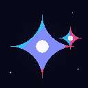
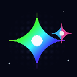

<div align="center">

# ✦ Google Gemini Descent ✦
### 시네마틱 픽셀 아트 · 대기권 하강 시뮬레이터 & GIF 애니메이션 스튜디오

<p align="center">
  
</p>

<p align="center">
  <strong>성층권 상공에서 구름을 가르고 광활한 대지와 바다의 수평선으로 하강하는 구글 제미나이 성좌의 시네마틱 도트 오디세이</strong>
</p>

<p align="center">
  <a href="./README.md"><strong>[🌐 English Documentation (Main)]</strong></a> &nbsp;·&nbsp; <strong>[🇰🇷 한국어 버전 (현재 문서)]</strong>
</p>

<p align="center">
  
  
  
  
  
  
</p>

[✨ 실시간 데모 체험](#-핵심-기능-key-features) · [🎬 시네마틱 뷰포인트](#5-시네마틱-뷰포인트-북마크--퀵-점프-엔진) · [🎨 GIF 스튜디오](#6-브라우저-내장-gif-애니메이션-스튜디오-gif89a) · [🎮 조작 가이드](#-인터랙티브-조작-가이드) · [🚀 로컬 실행 방법](#-로컬-개발-및-실행-방법)

---

</div>

<br />

## 🌌 프로젝트 소개 (Overview)

**Google Gemini Descent**는 상공 수백 킬로미터 열권에서 출발하여 대기권을 관통해 지표면으로 하강하는 **구글 제미나이(Google Gemini)** 성좌를 감성적인 16-bit 레트로 픽셀 아트로 구현한 시네마틱 인터랙티브 웹 애플리케이션입니다.

수학적으로 계산된 4첨점 슈퍼엘립스 성좌 렌더링, 4대 시간대(새벽·정오·황혼·미드나잇) 및 5대 기상 시뮬레이션, 신화적 천상룡(Celestial Dragon) 조우 이벤트, 밤하늘을 수놓는 **픽셀 유성우 & 수평선 잔상광 시스템**, 사용자가 즐겨찾는 대기-기상 조합을 저장하는 **시네마틱 뷰포인트 북마크 엔진**, 그리고 브라우저 내에서 직접 고화질 GIF를 굽는 **GIF 애니메이션 스튜디오**를 완벽하게 제공합니다.

<br />

---

## ✨ 핵심 기능 (Key Features)

### 1. ✦ Google Gemini 4포인트 슈퍼엘립스 픽셀 아트 엔진
- **정밀 기하학적 곡률 래스터라이징**: `(abs(x)/a)^0.55 + (abs(y)/b)^0.55 <= 1` 수식을 픽셀 그리드에 직접 매핑하여 제미나이 고유의 오목한 4방향 유선형 곡면을 서브픽셀 단위로 구현.
- **시그니처 브랜드 그라데이션**: 순백의 다이아몬드 코어 발광과 청록(`Cyan #38bdf8`), 코발트(`Sky #0ea5e9`), 바이올렛(`Violet #818cf8`), 퍼플(`Purple #a855f7`), 마젠타(`Magenta #f43f5e`), 핑크(`Pink #ec4899`)로 이어지는 6색 스펙트럼.
- **동반 위성별 (Companion Satellite Star)**: 중심 성좌 주위를 3D 나선으로 공전하는 쌍성계(Binary Star) waltz 애니메이션.

### 2. 🌠 시간대 연동 픽셀 유성우 & 하단 잔상광 시스템
- **야간/미드나잇 자동 활성화**: 시간대가 '트와일라잇(밤)' 또는 '심우주 미드나잇'에 도달하면 밤하늘 상층에서 무작위로 긴 궤적을 그리며 쏟아지는 픽셀 유성우가 발동.
- **다계층 픽셀 꼬리 (Tail)**: 중심부 순백 다이아몬드 코어와 4방향 미세 십자 플레어, 그리고 Cyan/Violet의 부드러운 32~60px 길이 픽셀 테일.
- **화면 하단 은은한 잔상광 (Bottom Residual Light Afterglow)**: 유성이 하강하여 수평선에 충돌할 때 지표면에 잔상 에너지를 축적하고, 2.5~4초 동안 지평선을 은은하게 비추는 방사형 잔류광 연출.
- **즉시 소환 (Surge Trigger)**: 하단 HUD의 `[유성우 소환]` 버튼을 통해 6연속 캐스케이드 유성우를 즉각 밤하늘에 발사 가능.

### 3. 🐉 신화적 드래곤 조우 (Celestial Dragon Engine)
- **보이드 자수정 천상룡 (Void Amethyst Celestial Dragon)**: 정밀 6프레임 픽셀 아트 비행 스프라이트 엔진 탑재. 크로마키 투명화, 꼬리 크리스탈 플레어, 가슴의 제미나이 발광 코어 및 우주 성진(Stardust) 궤적 파티클 방출.
- **5대 용족 픽셀 변종**: 공허 자수정룡 (Void Amethyst), 서리빛 빙룡 (Frost), 비취 성운용 (Emerald), 태양 홍염용 (Solar), 진홍 겁화용 (Crimson)의 실시간 HSL 색상 변환 렌더링.
- **대기 가속 & 성좌 공명 발광**: 드래곤 통과 시 구름 이동 속도가 **+275% 폭증**하며, 제미나이 성좌가 초고열 공명 발광.
- **입체 사운드**: 날개짓 풍압음과 멀리서 울려 퍼지는 거대한 드래곤 포효 사운드 3초 페이드 인/아웃.

### 4. 🪐 멀티 AI 성좌 랑데부 & 천체 도감 (Observatory Codex)
- **OpenAI GPT**: 에메랄드 양자 2중 나선 소용돌이와 사이버네틱 고주파 지터 쉐이크.
- **Anthropic Claude**: 태양 홍염 중력 포물선과 코로나 지진파 카메라 쉐이크.
- **DeepSeek**: 유체역학적 사인파 고래 유영과 퀀텀 소나 링 파동 (진행 방향에 맞춘 헤드 앵글 정렬).
- **하강 궤적 & 밀도 차트 (Recharts Visualizer)**: 천체 도감 모달 내에서 각 AI 성좌의 고도별 대기 밀도, 중력 가속도, 항력 계수(Drag Coefficient)를 실시간 차트로 시각화.
- **카메라 초점 트래킹 (Focus Tracking)**: 성좌 소환 시 해당 개체로 부드럽게 줌인(Zoom-in)되어 궤적과 파티클을 추적한 뒤 복귀.

### 5. 🎬 시네마틱 뷰포인트 북마크 & 퀵 점프 엔진
- **5대 상징적 프리셋**:
  - `트와일라잇 오로라 하강`: 황혼의 자줏빛 대기 속을 일렁이는 몽환적인 코스믹 오로라 커튼.
  - `미드나잇 유성우 갈라`: 깊은 밤하늘을 가르는 픽셀 유성우 폭포와 수평선 잔광.
  - `새벽의 운해 비행`: 새벽 햇살이 스며드는 짙은 아침 안개와 고요한 활공.
  - `황금빛 정오의 슈퍼노바`: 태양 직하점의 눈부신 황금빛 렌즈 플레어와 쾌청한 시야.
  - `사이버 템페스트 스피드런`: 번개 폭풍우를 가르는 초음속 마하 가속 돌파.
- **커스텀 뷰포인트 저장 (Bookmarking)**: 사용자가 감상 중인 시간대, 날씨, 하강 속도, CRT 스캔라인, 구름 밀도, 바람 세기를 원클릭으로 북마크에 저장 (`localStorage` 영구 보존).
- **HUD 퀵 점프 리본**: 하단 제어 데크 상단에 배치된 퀵 점프 리본으로 즉시 원하는 시각 환경으로 1프레임 즉시 전환.

### 6. 🎨 브라우저 내장 GIF 애니메이션 스튜디오 (`GIF89a`)
- **실시간 픽셀 프리뷰**: 캔버스에서 1:1 도트 렌더링을 실시간 재생, 일시정지, 프레임 확인.
- **4가지 프리셋 모드**:
  - `시그니처 복합 (Combined)`: 코어 발광 + 레이저 플레어 깜빡임 + 360° 크로마틱 색상 순환
  - `반짝임 깜빡임 (Sparkle Blink)`: 숨쉬는 펄스와 4방향 광원 스파이크, 은하 성진(Stardust)
  - `색상 순환 (Color Cycle)`: 6색 브랜드 스펙트럼의 부드러운 위상 회전
  - `서리빛 글레이셜 (Frost Aurora)`: 시안과 딥 블루의 극광 오로라 펄스
- **정밀 커스텀 옵션**: 해상도(64px, 128px, 256px), FPS(10, 14, 20), 루프 길이(1.5s~3.0s), 동반 위성별 토글, 투명 배경(Transparent Alpha) 지원.
- **원클릭 로컬 다운로드**: NeuQuant 팔레트 양자화 알고리즘으로 무손실 압축된 `.gif` 파일을 브라우저에서 즉시 저장.

### 7. 🎵 절차적 코스믹 사운드스케이프 (Web Audio API)
- 화이트 노이즈와 로우패스 필터 기반의 리얼타임 대기 바람 소리.
- 55Hz(A1) 서브베이스 코스믹 드론 사운드.
- 유성우 크리스탈린 징글 및 드래곤 포효/날개짓 합성 사운드.
- 오중 음계(Pentatonic) 기반의 영롱한 스타라이트 신스 차임벨.

### 8. 🎛️ 실시간 대기권 고도계 & 텔레메트리 게이지
- **실시간 대기 계층 래더**: 140km 상공에서 지표면(0km)까지 **열권(Thermosphere)**, **중간권(Mesosphere)**, **성층권(Stratosphere)**, **대류권(Troposphere)**, **지표면(Surface)**을 통과하는 수직 고도계.
- **물리 환경 텔레메트리**: 기압(`hPa`), 온도(`°C`), 하강 비행 속도(**마하 M 1.16**) 실시간 디지털 계측.
- **대기 마찰 플라즈마 림 발광**: 마하 초음속 돌파, 대기층 경계 통과, 성운룡 조우 시 화면 가장자리에 붉은빛 압축 플라즈마 경보 발생.

### 9. ⌨️ 프로 키보드 단축키 커맨드 덱 & 치트시트 (`[?]` / `[H]`)
- 마우스 없이 키보드 하나로 모든 시네마틱 연출을 통제:
  - `[Space]`: 시간 자동 순환 정지 / 재생
  - `[1] ~ [4]`: 새벽 / 정오 / 트와일라잇 / 미드나잇 즉시 점프
  - `[D]`: 성운룡 조우 출현
  - `[M]`: 픽셀 유성우 폭포 발사
  - `[G]`, `[C]`, `[S]`: GPT, Claude, DeepSeek 성좌 소환
  - `[V]`: 뷰포인트 서랍 열기
  - `[Z]`: 시네마틱 젠 모드 토글
  - `[?]` / `[H]`: 네온 픽셀 단축키 안내 모달

### 10. 📊 8밴드 레트로 LED 오디오 스펙트럼 비주얼라이저
- 사운드 버튼 옆에 배치된 8밴드 아케이드 LED 스펙트럼 바.
- 바람 속도, 코스믹 서브베이스 웅웅거림, 유성우 크리스탈 차임, 드래곤 포효음에 맞춰 그린-시안-앰버-로즈 그라데이션으로 실시간 비주얼라이징.

### 11. 🎬 스마트 오토 하이드 (Smart Zen) & 픽셀 워터마크
- **3.5초 스마트 유휴 페이드**: 조작이 없을 시 상/하단 HUD와 마우스 커서가 부드럽게 사라져 순수 도트 아트를 감상할 수 있는 스마트 젠 모드 (입력 시 0.1초 즉시 복구).
- **무손실 PNG 캡처 워터마크**: 스크린샷 저장 시 하단에 감성적인 SF 텔레메트리 워터마크(`✦ GOOGLE GEMINI DESCENT // ALT 42.8 KM // TWILIGHT AURORA · CLEAR`) 자동 인쇄.

### 12. ✨ 인터랙티브 커서 별빛 궤적 & 클릭 노바 폭발 효과
- **마우스 커서 별빛 잔상광**: 캔버스 위에서 마우스나 터치 조작 시 커서 동선을 따라 구글 제미나이 4색(시안, 바이올렛, 골드, 화이트)의 은은한 미세 픽셀 별빛과 잔상이 흩날리며 하강.
- **클릭 별빛 폭발 (Nova Burst)**: 화면 클릭 시 16방향으로 화려하게 뻗어나가는 방사형 별빛 스파크와 팽창하는 퀀텀 충격파 링이 터져 나오며 영롱한 스타라이트 크리스탈 사운드 피드백 동시 재생.

### 13. 📹 인브라우저 60FPS 비디오 레코더 (WebM/MP4 캠코더 `[R]`)
- **실시간 60FPS 캔버스 직접 녹화**: `HTMLCanvasElement.captureStream(60)` 기술을 적용하여 480×300 픽셀 버퍼의 고주사율 프레임을 부드럽게 캡처.
- **레트로 캠코더 HUD 표시기**: 녹화 중 좌측 상단에 붉은 점멸등과 함께 `● REC 00:04:12 [60 FPS // HD]` 타이머 및 고해상도 캠코더 HUD 제공.
- **범용 코덱 자동 폴백 & 안전 시간 제한**: `video/webm;codecs=vp9`부터 VP8, MP4 코덱까지 브라우저 호환성을 자동 감지하며, 60초 자동 보호 캡핑 후 즉시 파일 다운로드.
- **원클릭 단축키 및 툴바 토글**: `[R]` 키 또는 툴바의 60FPS 녹화 버튼으로 즉시 녹화 시작/중지 및 자동 다운로드.

### 14. 🕹️ 글라이더 직접 비행 조종 모드 (`[X]`) & 오토파일럿 입력 평활화 (`[Y]`)
- **방향키/WASD 직접 조종**: `[Arrow Keys]` 또는 `[WASD]` 키를 통해 하강 중인 구글 제미나이 성좌를 플레이어가 직접 조종.
- **공기역학적 롤 뱅킹 기울기**: 좌우 선회 시 부드러운 뱅킹 롤 각도 및 자연스러운 관성 보간, 중립 복귀 물리 시뮬레이션.
- **오토파일럿 입력 평활화 (`[Y]`)**: 뱅킹 각속도 변화율(slew-rate)을 제한하고 급격한 좌우 연타/반대 방향 입력 시 충격(whiplash)을 완화하여 부드러운 기동성 보장.
- **Framer-Motion 다이내믹 펄싱 인디케이터**: 상단 HUD에 오토파일럿 작동 상태를 표시하며, 입력 평활화가 활발히 작동 중일 때는 에메랄드 그린 점멸(`SMOOTHING`) 효과를, 순항 중에는 시안(`ACTIVE`) 상태를 실시간 연출.
- **고속 플라즈마 추진 노즐 분사구**: 비행 조종 및 가속 시 성좌 후방에서 뿜어져 나오는 시안/인디고/코어화이트 3색의 강력한 로켓 플라즈마 배기 화염 파티클 렌더링.
- **실시간 텔레메트리 HUD**: 상단 텔레메트리에 실시간 기체 기울기(`ROLL +12.4°`), 조종 상태 및 오토파일럿 직관적 토글 제공.

### 15. 🗺️ 성간 별자리 성도 & 천체 항법 뷰 (`[K]`)
- **고대 성좌 천체도**: 대기권 상층부에 수놓아진 **큰곰자리(북두칠성/Ursa Major)**, **카시오페이아자리(Cassiopeia)**, **쌍둥이자리 넥서스(Gemini Twins Nexus - Castor & Pollux)** 성좌 렌더링.
- **네온 대시 라인 & 펄스 스타 노드**: 시안/바이올렛 네온 점선 기하학과 부드럽게 점멸하는 주요 별빛 노드 연결.
- **인터랙티브 로어 카드 팝업**: 별자리 근처에 마우스 호버 시 해당 성좌의 기원, 주요 항성 명칭, 천체 좌표를 실시간 카드 오버레이로 제공.

### 16. 📻 3-채널 코스믹 로파이 신스 라디오
- **실시간 온에어 3대 절차적 신스 채널**:
  - `Deep Space Drone`: 55Hz 서브베이스 사인파 명상음과 필터링된 성간 태양풍 노이즈.
  - `Lo-Fi Stardust Lounge`: 따뜻한 아날로그 테이프 질감과 펜타토닉 음계 기반의 몽환적인 로즈풍 스타 차임.
  - `Cyber Tempest Pulse`: 128 BPM 16비트 아르페지오 일렉트로 베이스 펄스와 다이내믹 주파수 스윕.
- **사운드스케이프 스튜디오 통합**: 사운드 스튜디오 모달 내에서 "ON AIR" 라이브 인디케이터와 함께 원하는 오디오 채널을 실시간 전환.

### 17. 🌌 블랙홀 중력 렌즈 왜곡 & 가르강튀아 특이점 (`[B]`)
- **상대론적 도플러 강착원반**: 광속 회전하는 강착원반의 비대칭 도플러 효과(접근하는 시안 청색편이, 멀어지는 마젠타 적색편이) 정밀 렌더링.
- **시공간 중력 왜곡 및 인력 벡터**: 특이점 발동 시 구글 제미나이 성좌, 비행 조종 글라이더 궤적, 마우스 별빛 입자를 블랙홀 중심으로 부드럽게 끌어당기는 실시간 중력 물리 연산.
- **다중 광자구 및 중력파 펄스 링**: 사건의 지평선(Event Horizon) 칠흑 코어와 맥동하는 동심원 중력파 왜곡 왜도 렌즈 효과.
- **38Hz 서브베이스 중력파 음향**: 시공간 압축을 형상화한 초저주파 서브베이스 웅웅거림과 주파수 스윕 왜곡 신디사이저 사운드.

### 18. 🕹️ 아케이드 스타더스트 링 컬렉터 & 스코어링 챌린지 (`[T]`)
- **상승 네온 스타더스트 링**: 대기층 상공을 향해 떠오르는 네온 스타더스트 링과 회전하는 보조 유도 비콘.
- **실시간 충돌 판정 & 콤보 배율 시스템**: 제미나이 성좌와의 서브픽셀 충돌 판정을 통해 연속 통과 시 단계별 콤보 배율(`x1`, `x2`, `x4`, `x8`) 적용.
- **레트로 아케이드 HUD & 영구 최고 점수**: 상단 실시간 점수판(`SCORE`, `COMBO`, `HIGH`) 및 `localStorage` 브라우저 영구 최고 기록 갱신.
- **상승 펜타토닉 크리스탈 차임 사운드**: 콤보가 누적될수록 피치가 한 옥타브씩 상승하는 상쾌한 아케이드 수집 사운드.

### 19. 🛰️ 지구 저궤도 인공위성 편대 & 우주정거장 플라이바이 (ISS, 허블, 보이저, 스타링크)
- **16비트 정밀 우주선 픽셀 스프라이트**: 열권 및 중간권 최상층(100~140km)을 공전하는 **국제우주정거장(ISS)**, **허블 우주 망원경**, **보이저 1호 탐사선**, **스타링크 편대 기차** 렌더링.
- **궤도 비행 역학 & 태양광 패널 반사광**: 실시간 횡단 궤도 운동, 태양광 패널의 눈부신 스펙큘러 섬광 및 점멸하는 적색/시안 항법 비콘.
- **인터랙티브 텔레메트리 호버 카드**: 위성 위에 마우스 호버 시 실시간 궤도 속도(`km/s`), 고도(`km`), 궤도 경사각, 발사 연도, 역사적 미션 로어가 담긴 정보 카드 출력.
- **클릭 모스 부호 무선 통신음**: 위성 클릭 시 삑- 하는 정밀 합성 아날로그 라디오 텔레메트리 피드백 비프음 재생.

### 20. ⚡ 수퍼셀 다이내믹 뇌우 & 프랙탈 포크 낙뢰 시스템
- **재귀 프랙탈 분기 낙뢰 (Forked Lightning)**: 뇌운 중심부에서 대기권을 뚫고 수직·사선으로 갈라지며 뻗어 내려오는 리얼 프랙탈 번개 가지 방전.
- **볼류메트릭 구름 내부 역광 섬광**: 번개가 칠 때마다 짙은 먹구름 내부가 투과 발광하며 캔버스 전체를 비추는 대기 플래시 조명 효과.
- **세인트 엘모의 불 (St. Elmo's Fire)**: 뇌우 발생 시 구글 제미나이 성좌의 4개 뾰족한 끝단에 지직거리며 맺히는 초고전압 정전기 코로나 불꽃 방전.
- **음속 지연 저주파 천둥소리**: 번개 발생 지점으로부터 음속 전달 거리를 시뮬레이션한 입체 저음 잔향 천둥소리 합성.

### 21. 🛡️ 제품급 안정성 & 크래시 복구 에러 바운더리 아키텍처
- **중앙 집중식 시뮬레이션 스토어**: 타입 안전한 리듀서 기반 중앙 상태 저장소(`SimulationContext`)를 도입하여 프롭 파편화를 제거하고 결정론적 물리 상태 전이를 보장.
- **복원력 높은 React 에러 바운더리**: 캔버스 래스터라이저, Web Audio 컨텍스트 등 예기치 않은 런타임 예외 발생 시 하얀 먹통 화면 대신 인터랙티브 "텔레메트리 링크 복구" UI를 제공하여 원클릭 상태 복원.
- **경계값 및 스트레스 종합 테스트**: 초고속 프레임 순환, 극한 고도 경계, 다중 개체 동시 충돌, 시스템 시간 야간 감지, 천체 조우 진동 스케일링, 가우시안 소프트 섀도우를 포괄하는 219개 자동화 단위/통합 테스트 100% 통과 (18개 테스트 스위트).

### 22. ⚙️ 비행 시스템 환경설정 & 오디오 프로필 모달 (`[,]`)
- **정밀 그래픽 퍼포먼스 버젯**: 파티클 밀도 수용량 조절(`Low` / `Balanced` / `Ultra`), 주사율 목표(30 FPS / 60 FPS / 무제한), 지진파 화면 흔들림 강도, CRT 스캔라인 및 발광 블룸 온오프.
- **스튜디오 오디오 믹서 콘솔**: 마스터 게인, 대기 바람 소리, 로파이 신스 라디오, 인터랙티브 효과음 볼륨을 개별 슬라이더로 조절하며 백그라운드 탭 자동 음소거 지원.
- **무손실 스토리지 살균화 (Sanitization)**: 손상되거나 버전이 다른 `localStorage` 데이터를 안전하게 감지하여 결함 없이 정상 기본값으로 자동 교정 복구.

### 23. 🌐 인터랙티브 3D 성좌 천체 홀로그램 & 위치 강조 시스템 (`ObservatoryCodexModal`)
- **오일러 3D 천구 수학 엔진**: 오일러 피치(Pitch), 요(Yaw), 롤(Roll) 짐벌 회전과 투시 원근 투영을 지원하여 천구 적도(Celestial Equator), 본초 자오선(Prime Meridian), 북극성 축(NCP Polar Axis) 및 4대 AI 성좌(Gemini, GPT, Claude, DeepSeek)의 3차원 성좌 위상 렌더링.
- **서브픽셀 레이캐스트 별 클릭 판정 & 타겟 조준선**: 3D 회전 상태의 별 노드를 클릭하면 광선 추적(Raycast) 알고리즘이 최근접 별을 판정하여 네온 발광 타겟 조준선과 원형 하이라이트 링을 즉각 시각화.
- **실시간 천문 좌표 HUD & 미니 천구 돔 레이더**: 클릭된 항성의 정밀 적경(RA $\alpha$), 적위(Dec $\delta$), 고도/방위각(Alt/Az), 역원(Epoch J2000) 정보를 오버레이하고, 미니 돔 레이더를 통해 실시간 천구 내 위치를 입체 매핑.
- **천체 도감 듀얼 모드 전환**: 천체 도감 내에서 **3D 성좌 천체 홀로그램 & 위치 강조** 모드와 **2D 대기 입자 방출 시뮬레이터** 모드를 자유롭게 전환.

### 24. 🎧 날씨 연동 3D 입체 음향 & 사운드 필터링 매트릭스 (`SoundscapeMixerModal`)
- **기상 모드별 실시간 DSP 필터 연동**: 현재 선택된 기상 모드(폭풍우, 오로라, 눈, 안개, 맑음)에 따라 Web Audio biquad 필터와 공명 주파수를 실시간 조율:
  - *폭풍우 (Thunderstorm)*: 웅장한 저주파 천둥 굉음과 음속 지연 공간 잔향음 증폭.
  - *오로라 (Aurora)*: 몽환적인 코스믹 신스 하모니와 다이내믹 밴드패스 레조넌스 스윕 강조.
  - *눈 & 안개 (Snow & Mist)*: 대기에 스며드는 부드러운 로우패스 댐핑과 고요한 백색소음 바람.
  - *정오 쾌청 (Golden Clear)*: 맑고 영롱한 고주파 크리스탈 펜타토닉 차임 사운드.
- **공간 패닝 및 마스터 믹서**: 스테레오 3D 음장 공간감과 슬라이더 기반의 독립 볼륨 버스 제어.

### 25. ☁️ 물리 연동 구름 유체역학 & 윈드 시어 엔진 (`AtmosphereStudioDrawer`)
- **대기 항력 및 하강 속도 물리 연동**: 구름의 흐름 속도와 볼류메트릭 입자 밀도가 현재 기상 모드, 고도별 기압층, 하강 비행 속도(마하 가속)와 정밀하게 역학 연동.
- **다계층 윈드 시어(Wind Shear)**: 열권, 중간권, 성층권 각 층위별 기류 난류(Reynolds Turbulence)를 실시간 반영하여 생동감 넘치는 구름 층류 연출.

### 26. 💾 실시간 비행 상태 JSON 파일 임포트/엑스포트 엔진 (`SettingsModal`)
- **원클릭 JSON 비행 상태 내보내기**: 현재 비행 중인 고도 진행도, 기상 조건, 비행 속도 모드, 커스텀 대기 파라미터, 뷰포트 레이아웃, 스캔라인/글라이더/성도/아케이드 모드 등 모든 비행 텔레메트리 상태를 단일 `.json` 파일(`gemini_flight_session_<timestamp>.json`)로 즉시 백업 다운로드.
- **안전한 JSON 가져오기 & 즉각 시뮬레이션 복원**: 저장된 비행 상태 JSON 파일을 불러오면 `sanitizeFlightSession` 유효성 검증 후 `localStorage`에 동기화하고, 현재 실행 중인 캔버스 비행 세션에 즉시 고도·기상·화면을 실시간 복원.
- **듀얼 백업 아키텍처**: 전체 커리어 통계/하이점수/북마크 뷰포트를 담은 블랙박스 프로필 백업과 실시간 비행 세션 상태 백업을 독립적으로 제어 가능.

### 27. 🌫️ 고도 및 기상 반응형 대기 연무 필터 `AtmosphericHazeFilter` (`PixelDescentCanvas`)
- **고도별 점진적 대기 선명도 조절**: 상공 140 km 열권의 완전 무결한 진공(Vacuum) 투명도에서부터, 고도가 지표면(0 km)에 가까워질수록 대기 분자 및 에어로졸 밀도가 증가하여 화면이 점진적으로 뿌옇게 부드러워지는 사실적인 원근 깊이감(Atmospheric Depth)을 제공.
- **기상별 고유 대기 산란 색상 및 연무 강도**:
  - *안개 (Mist)*: 가장 높은 연무 밀도와 소프트 대비 감쇄 및 미스티 펄(`Pearlescent`) 백색광 확산.
  - *비 (Rain)*: 습한 비안개 슬레이트 블루 대기 연화 및 채도 감쇄.
  - *눈 (Snow)*: 서리 맺힌 차가운 빙정 화이트 산란과 부드러운 하이키 확산.
  - *오로라 (Aurora)*: 이온화된 청록-에메랄드 극광 발광 연무.
  - *맑음 (Clear)*: 지평선 부근의 자연스러운 레일리(Rayleigh) 대기 산란광.
- **하이브리드 캔버스 & 뷰포트 후처리 파이프라인**: 캔버스 내부 볼류메트릭 깊이 그라데이션과 CSS 하드웨어 가속 필터(`blur`, `contrast`, `brightness`, `saturate`) 및 미세 에어로졸 증기 노드를 융합하여 레트로 픽셀 아트의 감성을 해치지 않으면서도 압도적인 공간적 몰입감 실현.

### 28. 🌦️ 기상 모드 대기 입자 트랜지션 엔진 (`weatherTransitionEngine.ts`)
- **스무스스텝 전선 스위프 블렌딩**: 기상 모드 변경 시 이전 기상에서 다음 기상으로의 즉각적인 전환 대신, 지평선과 고도 전선을 타고 자연스럽게 교차 블렌딩되는 대기 입자 트랜지션 효과 제공.
- **기상 전이 특화 응결 입자**: 폭풍우 빗방울, 눈꽃 빙정, 짙은 수증기 안개, 오로라 극광 이온 입자가 부드럽게 대기 중에 흩날리며 자연스러운 기후 변화 구현.

### 29. ☁️ 실시간 동적 불투명도 및 색상 깊이(밀도) 조절 `CloudShadowEngine`
- **고도 기반 그림자 농도 및 본그림자(Umbra) 선명도**: 상공 140 km 진공에서 지표면(0 km)으로 하강할수록 구름 아래 대륙과 해양 지형에 드리워지는 그림자가 점진적으로 짙고 뚜렷하게 맺히는 광학 물리학 구현.
- **풍향·풍속 기반 지형 미끄러짐 드리프트 애니메이션**: 풍향(`windX`)과 풍속(`windSpeed`) 벡터에 따라 구름 그림자가 지형 능선과 대륙 위를 유려하게 미끄러지듯 이동하는 연속 글라이딩 및 공기역학적 전단 연신(Shear Stretch) 효과.
- **실시간 고도 및 기상 반응형 동적 불투명도 & 색상 깊이(밀도) 조절**:
  - *대기 경계층 대류 호흡 파동*: 현재 고도(`altitudeKm`)에 따라 저고도 대류권에서는 풍부한 유기적 호흡 진폭(±8% ~ ±14%)과 깊은 흑요석(Obsidian) 색상 깊이를 형성하고, 고고도에서는 층류 미세 숨결로 자동 감쇄.
  - *기상 조건별 맞춤 색조 및 농도 제어*: 폭풍우(깊은 남색-차콜 음영 및 고대비), 눈(고대비 인디고), 안개(소프트 슬레이트 확산), 오로라(지자기장 보라-청록 색조 공명 펄스), 맑음(자연스러운 일광 대류 호흡)을 실시간 반영.
- **고도 불투명도 시각화 디버그 오버레이 모드 (`[U]`)**:
  - 캔버스 위에 구름에서 지표면으로 투영되는 점선 벡터, 와이어프레임 타원, 본그림자 코어 윤곽 및 우상단 레트로 SF HUD 텔레메트리 터미널(`renderCloudShadowDebugOverlay`)을 실시간 렌더링하여 고도, 10단계 불투명도 바, 광학 밀도 배율, 색상 깊이, 드리프트 속도, 대류 호흡 파동 상태를 한눈에 모니터링 가능.
- **고도 변화 실시간 밀도 수치 툴팁 (Floating Density Tooltip)**:
  - 하강 비행 중 고도가 변화하거나, 지형 그림자 영역에 마우스 포인터를 올리거나, 디버그 모드가 켜질 때 고도층, 실시간 동적 불투명도(%), 광학 밀도 배율, 색상 깊이 배율, 바람 전단각, 색상 스와치를 실시간 수치로 표시하는 인터랙티브 툴팁 제공.

### 30. 🌙 사용자 로컬 시스템 시간 기반 자동 다크 모드 & 심우주 미드나잇 (`systemTimeAutoTheme.ts`)
- **실시간 로컬 시스템 시간 감지**: 사용자의 디바이스 로컬 시스템 시각을 앱 실행 시 자동으로 감지.
- **야간 시간대 자동 로드 (오후 8시 ~ 오전 6시)**: 20:00부터 06:00 사이(`hours >= 20 || hours < 6`) 앱 접속 시, 자동으로 **'다크 모드'** 테마를 DOM에 적용하고, 비행 일주 위상을 **3단계 '심우주 미드나잇(Midnight, `cycleProgress = 0.77`)'** 및 기상을 **'눈 내리기(Alpine Snowfall)'**로 즉각 자동 로드.
- **스마트 HUD 자동 알림 토스트 배너**: 접속 시 감지된 로컬 시간과 적용된 미드나잇 설정을 7초간 플로팅 토스트 배너로 안내하며, 원클릭 닫기 제공.
- **사용자 제어 설정 토글**: 환경설정 모달(`SettingsModal` / `[,]`)의 '접근성 & UX' 탭에서 언제든지 로컬 시간 기반 자동 야간 모드 전환(`autoSystemNightTheme`) 기능을 켜거나 끌 수 있도록 지원.

### 31. 🌫️ 가우시안 블러(Gaussian Blur) 기반 소프트 섀도우 캔버스 필터 (`CloudShadowEngine`)
- **자연스러운 대기 반그림자(Penumbra) 광학 분산**: 캔버스 2D 렌더링 단계에서 하드웨어 가속 `ctx.filter = blur(...)` 필터를 적용하여 인위적인 픽셀 경계면을 제거하고, 행성 대기권을 통과하는 태양광의 부드러운 산란 반그림자를 완벽하게 재현.
- **고도별 동적 블러 반경 조절 (`calculateCloudShadowBlurRadius`)**:
  - *초고도 (60 km ~ 140 km)*: 두터운 대기 기둥을 통과하는 긴 레일리 산란 경로로 인해 그림자 윤곽이 넓고 부드럽게 퍼짐(3.5px ~ 6.0px).
  - *저고도 대류권 (< 15 km ~ 0 km)*: 지표면과 구름의 거리가 가까워지며 반그림자 확산각이 좁아져 뚜렷하고 선명한 본그림자 코어(0.8px ~ 1.8px) 형성.
- **기상 조건별 광학 분산 변조**: 짙은 안개(+1.4px) 및 소나기(+0.6px)에서는 수증기 입자로 인해 빛 분산이 확장되며, 차가운 고산 설원(-0.3px)에서는 시각적 대비가 높아져 그림자 경계면이 더욱 선명하게 맺힘.
- **실시간 텔레메트리 연동**: 디버그 오버레이 터미널(`[U]`) 및 마우스 호버 플로팅 툴팁에 실시간 가우시안 소프트 블러 수치(`SOFT BLUR: X.Xpx`)를 표시.

### 32. ⚡ 천체 조우 진동 강도 조절 슬라이더 (`1 ~ 10`) 및 전역 상태 연동
- **섬세한 1~10단계 햅틱 & 화면 흔들림 제어**: 환경설정 모달(`SettingsModal` / `[,]`)의 '그래픽 및 퍼포먼스' 탭에 1부터 10까지 조절 가능한 '천체 조우 진동 강도' 슬라이더를 도입하여, 인공지능 성좌 조우(GPT, Claude, DeepSeek) 및 블랙홀 특이점 소환 시 발생하는 화면 요동(Jitter)과 기기 햅틱 진동 강도를 정밀 튜닝.
- **전역 상태 중앙 동기화**: `UserSettingsProfile`의 `encounterShakeIntensity`와 `SimulationContext`의 `SET_ENCOUNTER_SHAKE_INTENSITY` 액션을 통해 중앙 집중식 관리되며, `localStorage`에 자동 영속화.
- **`handleEncounterTrigger` 함수 실시간 물리 반영**:
  - *화면 지터 변위 배율*: 설정 수치에 따라 최소 $0.35\times$(1단계)부터 $1.80\times$(10단계)까지 키프레임 변위(`getScreenJitterKeyframes`)를 동적으로 스케일링하여 `<motion.div>`에 반영.
  - *햅틱 진동 펄스 연장/압축*: `getHapticPattern` 및 `triggerCelestialHaptic`에 설정 강도를 전달하여 디바이스 진동 시간 및 패턴을 유기적으로 변조.
  - *지터 잔여 지속 시간*: 강도에 따라 320ms(1단계)에서 520ms(10단계)까지 충격 지속 시간을 유연하게 조절.

### 33. 🎬 Framer Motion `layoutId` 기반 하단 푸터 뷰 전환 부드러운 애니메이션
- **`<LayoutGroup id="bottom-footer-hud-controls">` 통합 오케스트레이션**: 표준(Standard) 뷰와 시네마틱(Cinematic) 뷰 간 전환 시 하단 푸터 제어 버튼들이 화면상에서 뚝 끊기거나 깜빡이지 않고, 유기적으로 미끄러지듯 이동하여 도킹되는 스프링 물리 트랜지션 구현.
- **공유 버튼 간 유기적 `layoutId` 바인딩**:
  - `footer-btn-layout-toggle`: 표준 모드의 "시네마틱 [Z]" 버튼과 시네마틱 모드의 "컨트롤 보기 (표준 복원)" 버튼 간의 위치 및 크기 보간.
  - `footer-btn-play-pause`: 시간 자동 흐름 시작/일시정지 버튼이 데크 중앙에서 우측 플로팅 독으로 즉시 도킹.
  - `footer-btn-viewpoints`: 뷰포인트 북마크 버튼이 하단 퀵 점프 리본과 플로팅 독 사이를 유연하게 이동.
  - `footer-btn-codex`, `footer-btn-atmosphere`, `footer-btn-gif-studio`, `footer-btn-soundscape`: 천체 도감, 대기 스튜디오, GIF 스튜디오, 사운드스케이프 버튼이 표준 푸터와 시네마틱 독 간을 1:1로 매끄럽게 모핑.
- **개별 제어 요소 탄성 재배치**: 기상 선택 칩, AI 성좌 소환 버튼, 타임 슬라이더, 시간대 점퍼, 속도 모드 버튼에 개별 `layout` 및 고유 `layoutId`를 부여하여 뷰 전환 시 버튼들이 부드럽게 펼쳐지거나 수축하는 시각적 쾌감 선사.

### 34. 🐉 캔버스 중심 근접도 기반 드래곤 조우 동적 오디오 크로스페이딩 (`dragonAudioProximity.ts`)
- **캔버스 중심 거리 기반 실시간 볼륨 보간**: 드래곤이 화면 밖에서 날아와 캔버스 정중앙($x = \text{width} / 2$)에 도달할수록 포효 소리가 웅장하게 크레센도(Crescendo)되고, 중심을 지나 화면 밖으로 멀어질수록 부드럽게 감쇄(Decrescendo)되는 연속 크로스페이딩 구현.
- **C1 매끄러운 코사인 이징 곡선 (Smooth Cosine Easing)**:
  - 경계면 도함수가 0인 $\text{proximity} = 0.5 \times (1 + \cos(\text{norm} \times \pi))$ 수학 곡선을 적용하여 급작스러운 클릭음(Click/Pop)이나 불연속 계단 현상 원천 방지.
  - 정중앙에서 근접도 `1.0`(최대 볼륨), 청음 한계 반경 밖($\ge \text{width} \times 0.8$)에서 `0.0`(완전 페이드아웃).
- **실시간 주파수 & 입체 음향 연동**:
  - *동적 저역통과 필터(Biquad Lowpass)*: 원거리에서는 120Hz의 둔탁한 저주파 진동으로 시작하여, 중심 접근 시 440Hz까지 필터가 열리며 선명하고 압도적인 용의 포효음 발현.
  - *실시간 스테레오 패닝(Stereo Panning)*: 비행 궤적에 맞춰 좌측($-1.0$)에서 중앙($0.0$)을 거쳐 우측($+1.0$)으로 자연스럽게 스피커 음상이 이동.
  - *비행 종료 시 자동 페이드아웃*: 드래곤이 캔버스를 완전히 벗어나면 `stopDragonRoarAudio(0.6)`를 통해 잔향을 남기며 깔끔하게 세션 종료.

<br />

---

## 🖼️ 프리셋 GIF 갤러리 (Pre-rendered Showcase)

프로젝트에 미리 고품질로 렌더링되어 포함된 정적 GIF 에셋입니다 (`/public` 경로):

| 시그니처 복합 애니메이션 | 스타라이트 깜빡임 (Sparkle) | 스펙트럼 색상 순환 (Color Shift) |
|:---:|:---:|:---:|
|  |  |  |
| **`gemini_pixel_animated.gif`**<br/>37.2 KB · 14 FPS · 2.0s Loop | **`gemini_pixel_sparkle.gif`**<br/>33.8 KB · 12 FPS · 2.0s Loop | **`gemini_pixel_color_cycle.gif`**<br/>61.4 KB · 12 FPS · 2.5s Loop |
| 코어 발광 + 레이저 플레어 + 360° 색상 회전 | 화이트 코어 펄스 + 4축 십자 광선 플레어 | 6색 브랜드 스펙트럼의 부드러운 그라데이션 순환 |

<br />

---

## 🎮 인터랙티브 조작 가이드

화면 상/하단의 HUD 제어 데크 및 키보드 단축키를 통해 실시간으로 조작할 수 있습니다:

```
┌────────────────────────────────────────────────────────────────────────┐
│ [상단 툴바]                                                            │
│   • 뷰 모드 전환: [표준 HUD] / [분할 레이더 덱] / [시네마틱 젠 모드]   │
│   • 천체 도감: 3D 성좌 홀로그램, AI 성좌 스펙, 궤적 밀도 차트 & 로어   │
│   • 대기 스튜디오: 구름 밀도, 풍속, 흔들림 강도 정밀 슬라이더         │
│   • GIF 스튜디오: 픽셀 아트 애니메이션 커스텀 제작 및 다운로드        │
│   • 뷰포인트: 시네마틱 프리셋 로드 및 현재 대기 조합 북마크 저장       │
│   • 사운드 스펙트럼: 8밴드 실시간 LED 댄싱 비주얼라이저 + 사운드 조절  │
│   • 단축키 [?]: 화면 중앙에 뜨는 네온 픽셀 단축키 안내 치트시트 열기  │
│   • 도트 캡처: 4배 스케일링 무손실 PNG + SF 텔레메트리 워터마크 저장   │
├────────────────────────────────────────────────────────────────────────┤
│ [하단 제어 데크]                                                       │
│   • 퀵 점프 리본: 원클릭으로 즐겨찾는 시네마틱 뷰포인트 즉시 불러오기  │
│   • 기상 이벤트: [시간연동] [소나기] [눈 내리기] [안개] [오로라] [쾌청]│
│   • 성좌 소환: [GPT 출현] [Claude 출현] [DeepSeek 출현]                │
│   • 특수 이벤트: [드래곤 조우] (성운룡 비행) / [유성우 소환] (유성 폭포)│
│   • 시간대 점퍼: [새벽] [골든/정오] [트와일라잇(밤)] [미드나잇]        │
│   • 하강 속도: [느리게 (0.55x)] [표준 (1.0x)] [마하 (2.2x)]            │
│   • 비주얼 필터: CRT 브라운관 주사선, 스타 발광 궤적 라인 토글         │
└────────────────────────────────────────────────────────────────────────┘
```

<br />

---

### 10. 🛡️ 제품급 아키텍처 & 신뢰성 강화 엔진
- **로컬 저장소 기반 비행 상태 자동 복구 엔진 (Flight Session Auto-Recovery)**: 고도, 24시간 사이클 진행도, 기상 모드(소나기/설운/해무/오로라), 커스텀 대기 파라미터, 뷰포인트 점프 상태, 화면 분할 레이아웃 및 각종 모드 토글을 로컬 저장소에 상시 보존. `beforeunload` 및 `visibilitychange` 이벤트와 2.5초 스로틀링 저장을 결합하여 새로고침이나 브라우저 강제 종료 시에도 0.01초의 상태 손실 없이 완벽 복구하며, 복구 알림 배너와 원클릭 세션 초기화 기능 지원.
- **캔버스 컨텍스트 유실 및 GPU 복구 엔진 (Context Loss Guard)**: 브라우저 GPU 일시 크래시, 절전 모드 복귀 시 `contextlost` 및 `contextrestored`를 감지하여 캔버스 백킹 버퍼 강제 소멸을 방지(`preventDefault`)하고, 렌더 루프 동결 후 0.1초 내 2D 컨텍스트와 스프라이트를 자동 재초기화.
- **가비지 컬렉터(GC) 스터터링 제로: 파티클 오브젝트 풀링 (Object Pooling)**: 고정 크기(1,200개) 파티클 풀을 사전 할당하고 O(1) swap-and-pop 재활용을 통해 핫 렌더 루프 내 힙 메모리 할당(0 Bytes/frame)을 실현하여 미세 끊김 완전 방지.
- **키보드 입력 고스팅 & 포커스 가드 (Input Focus Guard)**: `Alt-Tab` 또는 브라우저 탭 이동 등으로 윈도우 포커스가 이탈할 때 비행 조종키(`WASD/방향키`) 입력 상태를 자동 클리어하여 조종 불능 현상 차단.
- **비행 모드 프로필 (Flight Mode Profiles)**: 그래픽 품질, 입자 수, FPS 제한, CRT 스캔라인, 블룸 효과, 화면 흔들림 및 마스터 음량을 패키지화한 4가지 빌트인 프리셋(*시네마틱 오디세이*, *퍼포먼스 & 에코*, *레트로 CRT 아케이드*, *스텔스 젠*) 및 사용자 맞춤 프로필 영구 저장/불러오기/삭제 기능.
- **고도 및 풍향/풍속 반응형 지형 구름 그림자 엔진 (`cloudShadowEngine`)**: 풍향(Wind Vector) 및 풍속 데이터에 실시간 반응하여 대륙과 해양 지형 위를 미끄러지듯 이동하는 연속 드리프트(Drift) 애니메이션, 고도차 시차(Layer Parallax), 공기역학적 전단 연신(Shear Stretch) 구현. 고도(140km ~ 0.4km) 하강에 따라 옅은 반그림자에서 짙고 선명한 본그림자로 응축되는 물리 시뮬레이션 적용.
- **기상 모드 대기 입자 트랜지션 블렌딩 엔진 (`weatherTransitionEngine`)**: 기상 변경 시 이전 기상과 다음 기상의 강수 입자(빗방울, 눈송이, 해무, 오로라)를 수학적 스무스스텝(Smoothstep) 및 코사인 이징으로 자연스럽게 크로스페이드. 기상 전선면(Front Veil)을 따라 응결 수증기, 빙정 결정, 이온 플럭스, 증발 스팀 등 특화 대기 입자를 동적으로 방출하며 실시간 HUD 전선 진행률 표시.
- **고도 기반 대기 연무 효과 (`AtmosphericHazeFilter`)**: 현재 고도와 주야간 날씨 사이클에 따라 실시간으로 대비, 밝기, 배경 블러를 미세 조절하여 저고도 하강 시 짙어지는 대기의 공간적 깊이감 및 원근감 렌더링.
- **비행 데이터 상태 JSON 임포트/익스포트**: `SettingsModal` 내에서 현재 비행 세션의 전체 텔레메트리 및 환경 설정을 파일로 즉시 백업 및 불러와 다른 기기와 완벽 동기화.
- **다국어 즉시 전환 (i18n)**: 한국어와 영어 간 실시간 HUD 원클릭 토글(`[KO / EN]`) 및 영구 언어 프로필 저장.
- **비행 기록 블랙박스 & 프로필 JSON 백업/복구**: 총 비행 거리, 수집한 스타더스트 링, 최고 득점, 재진입 사이클 기록을 원클릭으로 JSON 내보내기 및 스키마 검증 기반 복구 지원.
- **적응형 성능 가드 (Adaptive Performance Guard)**: 실시간 롤링 프레임 타임 분산 분석을 통해 FPS가 45 이하로 떨어질 경우 입자 예산(`ultra` -> `balanced` -> `low`)을 자동 조정하여 프레임 드랍 방지.
- **Web Audio 탭 가시성 자동 절전**: 브라우저 탭 전환 시 오디오 컨텍스트를 자동 일시 정지하여 CPU 및 배터리 소모를 방지하고 복귀 시 부드럽게 재개.
- **PWA 오프라인 지원**: Web App Manifest 및 서비스 워커를 통한 독립형 앱 실행 및 오프라인 정적 에셋 캐싱.
- **우주에서 구름층까지 3D 궤도 강하 시네마틱 줌인 엔진 (`cinematicOrbitalZoomEngine`)**: 앱 최초 기동 및 신규 비행 세션 시작(`[I]` 단축키) 시 고궤도 우주(380km/열권)에서 중간권, 성층권을 뚫고 대류권 구름층(~12km)으로 진입하는 4단계 3D 시네마틱 강하 시퀀스 구현. 3D 시점 피치 틸트(`-0.14 rad`에서 수평 `0 rad` 회복), 카메라 줌 스케일(`0.32x` -> `1.08x` -> `1.00x`), 우주 궤도 지구 대기 지평선 호(Planetary Horizon Limb), 대기권 재진입 하이퍼스페이스 스타라이트 워프 스트릭, 이온화 플라즈마 충격파, 구름층 돌파 시 수증기 응결 연무 효과 렌더링 및 Web Audio 절차적 초음속 풍절음/충격음 음향 합성, 실시간 강하 텔레메트리 HUD 및 스킵(`[Space]/[Esc]`) 지원.
- **비행 뱃지 & 마일스톤 업적 엔진 (`flightLogBadgeEngine`)**: 폭풍우 전선층 돌파 시 수여되는 `클라우드 피어서 (Cloud Piercer)`를 비롯하여 `궤도 강하 비행사`, `성운룡 조우자`, `스타더스트 에이스`, `오로라 항법사`, `대류권 저고도 안착`, `마하 파일럿`, `사건의 지평선` 등 실시간 마일스톤 업적 평가 및 HUD 뱃지 아이콘 덱 표시. Framer Motion 알림 팝업 배너, 절차적 팡파레 6화음 사운드 합성, 로컬 저장소 영구 보존 및 설정 모달 내 상세 도감 제공.

<br />

---

## 🛠️ 기술 스택 (Tech Stack)

- **UI Framework**: React 19 (Hooks, Functional Architecture)
- **Language**: TypeScript (Strict Typing, Zero Linter Warnings)
- **Styling**: Tailwind CSS v4 + Framer Motion
- **Graphics Pipeline**: Pure HTML5 Canvas 2D Context (`imageSmoothingEnabled: false`) & 3D Math Engine (Euler Rotations, Raycasting, Perspective Projections)
- **Visualization**: D3.js (천체 도감 대기 밀도 & 하강 궤적 차트)
- **GIF Encoder**: `gifenc` (NeuQuant 색상 양자화, GIF89a 바이너리 직렬화)
- **Sound Engine**: Web Audio API (BiquadFilter, Oscillator, GainNode, Weather DSP Matrix)
- **Icons**: Lucide React Icons
- **Bundler & Tooling**: Vite 6, TSX, Node.js Built-in Test Runner (`node:test`)

<br />

---

## 🚀 로컬 개발 및 실행 방법

### 요구 사항
- Node.js 18.0.0 이상
- npm 또는 pnpm / bun

### 1. 저장소 클론 및 패키지 설치
```bash
git clone https://github.com/rt030627-rgb/Google-ai-studio.git
cd Google-ai-studio
npm install
```

### 2. 로컬 개발 서버 실행
```bash
npm run dev
```
브라우저에서 `http://localhost:3000`으로 접속하여 시네마틱 픽셀 아트를 감상하세요.

### 3. 단위 테스트 실행 (Node Built-in Test Runner)
```bash
npm test
```
*208개의 고도 및 풍향/풍속 반응형 지형 구름 그림자(단조 농도 스케일링, 본그림자 선명도, 일주 태양광 벡터, 바람 드리프트 역학, 공기역학적 전단 연신, 레이어 시차, 사영 평탄화, 실시간 고도·기상 반응형 동적 불투명도 및 색상 깊이 조절, 대기 경계층 대류 호흡, 시각화 디버그 오버레이 모드, 고도 변화 실시간 밀도 툴팁 텔레메트리), 기상 모드 대기 입자 트랜지션(스무스스텝 전선 스위프, 동적 블렌드 가중치, 특화 응결 입자), 비행 모드 프로필(빌트인 프리셋, 맞춤 프로필 저장/삭제, 딥 매칭), 고도 기반 대기 연무 광학 수식, 성도 패스 배치 렌더링, AABB 공간 바운딩 박스 컬링, 다중 성좌 동시 활성화 확장성, 3D 성좌 수학적 위상, 오일러 회전 벡터 보존, 원근 레이캐스트 히트테스트, 기상 DSP 오디오 매트릭스, 기하학, 궤적 물리, 유성우 잔상광, 시네마틱 뷰포인트 엔진, 드래곤 스프라이트, 블랙홀 중력 왜곡, 아케이드 링 수집, 인공위성 비행 역학, 프랙탈 낙뢰 시스템, 비행 세션 자동 복구, 다국어 i18n 동기화, 블랙박스 백업 무결성, 적응형 성능 가드, 파티클 오브젝트 풀링 O(1) 순환, GPU 컨텍스트 복구, 환경설정 살균화, 에러 복구 및 극한 스트레스 단위 테스트가 100% 통과합니다.*

### 4. 프로덕션 빌드
```bash
npm run build
```

### 5. CLI로 GIF 일괄 재생성 (스크립트 실행)
```bash
npx tsx scripts/generate-gemini-gif.ts
```

<br />

---

## 📄 라이선스 (License)

This project is licensed under the **Apache-2.0 License** - see the LICENSE file for details.

<br />

<div align="center">
  <sub>Crafted with passion for pixel art and cosmic aesthetics ✦ Powered by Google Gemini & DeepMind Spirit</sub>
</div>
